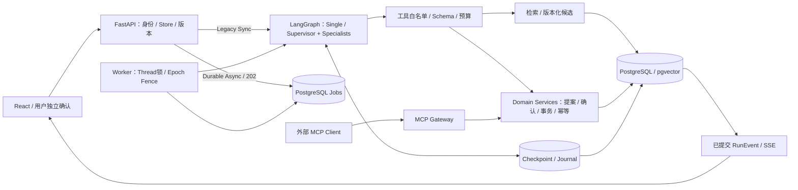
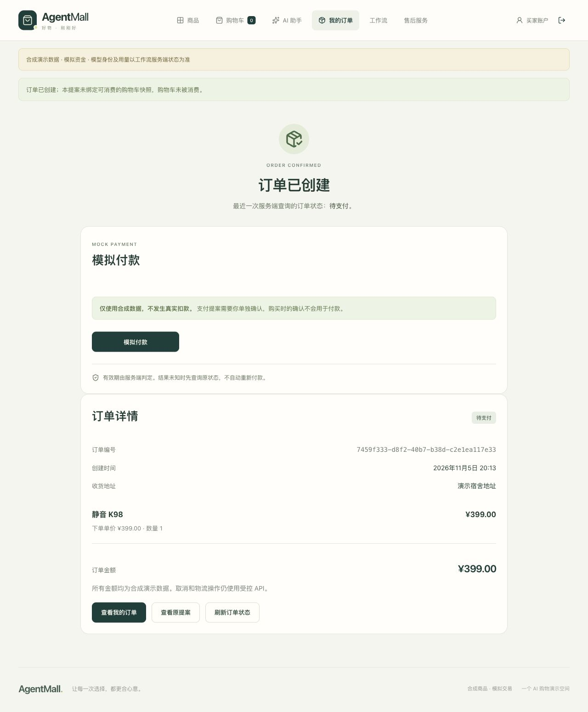

# AgentMall · 可恢复的 Agent 工作流与事务电商

AgentMall 是一个 AI 辅助开发的工程作品集：用户用自然语言比较商品、准备购买或售后提案，**模型负责建议，服务端负责权限、事实和事务，用户独立确认后才能提交交易**。项目重点是让 Agent 的失败可观察、写入可核验、工作流可恢复。

**Python 3.12 / FastAPI · LangGraph · PostgreSQL 17 / pgvector · React / TypeScript · MCP**

当前本地候选为 **V2.16 产品演示与 Multi-Agent 可靠性改进**，基于已合并的 V2.15 `main d18161d1eb40667f4658e745d2f58369767d67f5` / tree `548b2f8e3180027bb179c2b42a1c4367984ff489`。V2.15 合并后的 [main CI 43718887411](https://github.com/Cockatoo-xlk/AgentMall-Portfolio/actions/runs/43718887411) 已通过，这是基线证据；V2.16 的本地回归单独记录在[本轮交付](docs/V216_PRODUCT_DEMO.md)。本候选未 Push、未创建 PR、未发布或部署；V2.14 Release 继续 **ON_HOLD**。

[6分钟无Key演示](docs/DEMO_GUIDE.md) · [架构与源码](docs/ARCHITECTURE.md) · [工程案例](docs/ENGINEERING_CASES.md) · [评测结果](docs/EVALUATION_RESULTS.md) · [V2.16验收与复现](docs/V216_PRODUCT_DEMO.md) · [限制](docs/KNOWN_LIMITATIONS.md) · [10个面试问题](docs/INTERVIEW_TALKING_POINTS.md)

## 三分钟了解项目

| 问题 | 实现 | 可核查入口 |
|---|---|---|
| 模型说“买好了”，是否真的下单？ | 不可变 Proposal → 独立 Confirmation → Resume；服务端重验身份、版本、价格、库存，事务提交订单、库存预留与幂等回执 | [交易服务](backend/src/agentmall/orders/service.py)、[并发测试](backend/tests/test_order_concurrency.py) |
| HTTP 断开或进程中断后怎么办？ | Legacy Sync 与 Durable Async 并存；Worker 使用 Thread advisory lock、epoch fence、Journal 与官方 Checkpoint；SSE 只补读已提交事件 | [Worker](backend/src/agentmall/agents/worker.py)、[故障交错测试](backend/tests/test_recovery_interleavings.py) |
| 如何限制错误工具调用？ | Single / Supervisor + Specialists 共享领域服务；服务端校验当前意图、工具白名单、Schema、依赖和预算；不从模型参数接受权限 | [模型/工具校验](backend/src/agentmall/agents/model_control.py)、[写入顺序测试](backend/tests/test_agent_write_sequencing.py) |
| 推荐结果如何保持事实来源？ | 版本化候选、按品类约束；Jieba + PostgreSQL 全文 / 本地 BGE / RRF，购买前重新读取当前商品 | [候选记忆](backend/src/agentmall/agents/memory.py)、[真实检索范围](docs/REAL_RETRIEVAL.md) |
| 失败如何转为改进？ | 将可确认产品缺陷、协议异常、私有评测 Host 缺陷和证据不足分开，再添加独立合成回归 | [V2.15案例](docs/ENGINEERING_CASES.md)、[L8脱敏摘要](docs/evidence/v215/l8-summary.json) |

V2.15 已实现有界中文动作/量词解析、推荐比较与款数检查、可信提案状态观察及可读失败反馈。款数/比较完成检查只用于推荐只读场景；购买、退货和Bundle沿用各自完成语义。[当前实现与测试入口](docs/ENGINEERING_CASES.md)。

商家侧包含本店运营、草稿审核发布、独立索引与只读 Copilot；MCP 提供独立外部工具接口，内部 Agent 可以直接使用领域服务。它们不授予模型付款、退款或代用户批准的权限。

## 三条无Key产品演示

V2.16 页面从正式 API 展示约束、已核验候选数量、价格/库存/属性对比，展示每份 Proposal 的不可变快照、独立 Confirmation 及业务回执。候选是 Run 快照，当前库存用独立 GET 核对；`REQUESTED` 售后不是退款，`PENDING_PAYMENT` 订单不是付款。

- A：推荐与条件澄清，不产生交易；缺失用量时安全停止并保留 UNKNOWN。
- B：审阅购买提案后明确批准或拒绝，唯一订单、库存预留、响应丢失幂等核对及刷新读回。
- C：Multi 退货与替换购买，两次独立审批；后续模型失败时保留已提交的 Case。

[9条浏览器场景](frontend/tests/product-demo.spec.ts)使用 SDK MockTransport、真实 FastAPI / PostgreSQL / Checkpoint 和独立 SQL 查询；本轮通过情况见[回执](docs/evidence/v216/verification.json)。页面仅在服务端确认 Mock/Fixture 时标注 **OFFLINE DEMO / MOCK MODEL**。另有[受控离线验证命令](evals/CONTROLLED_OFFLINE.md)，不会调用旧 Simulator 的自动批准 / Recover 循环。

## 约6分钟讲解

[完整启动与清理步骤](docs/DEMO_GUIDE.md)使用现有 Docker Compose / `scripts/demo.py`，以合成账号进入 **Single / Legacy Sync / context-catalog**：

1. 推荐300元以内的静音键盘，订单增量0。
2. 改为无线、预算400元，展示新候选集合和保留偏好。
3. 选择当前第二款，检查 `WAITING_INPUT` 提案快照。
4. 以 **TEST_OPERATOR** 独立批准并 Resume，核对唯一 `PENDING_PAYMENT` 订单、付款增量0；刷新后读回原 Thread。

业务 API、PostgreSQL、事务和 Checkpoint 真实运行；模型为 **SDK MockTransport**，向量为 **Fixture Embedding**。依赖和镜像准备完成后可无 Provider 网络演示；首次构建可能下载依赖。普通 FastAPI 默认 `MODEL_DISABLED`。

截图来自历史合成 Demo，[来源与哈希](docs/evidence/portfolio-demo/verification.json)保留；不是 V2.15 新截图或真实 DeepSeek 实况。**VIDEO_NOT_RECORDED**。

## 可靠性结果与边界

| 证据 | 当前可表述状态 |
|---|---|
| V2.15 产品修复 / 自动回归 | **已实现 / LOCAL_OFFLINE_VERIFIED**；RC1后端1591 passed / 14 skipped / 3 warnings；Vitest132；Playwright119 / 0 retries；[RC1回执](docs/evidence/v215-rc1/verification.json) |
| RC1真实BGE专项 | **13 passed / 0 skipped**；固定六文件、CPU512维、Mock Provider；[审核与边界](docs/V215_RC1_REVIEW.md) |
| V2.15 真实 Provider / 新 L8 Episode | **NOT_RUN**；本轮不调用、不续评 |
| V2.15 集成状态 | [PR #5](https://github.com/Cockatoo-xlk/AgentMall-Portfolio/pull/5) 已合并；基线 main CI 43718887411 success；Release/部署 **NOT_PUBLISHED** |
| V2.16 本地产品回归 | 三条 UI / API / SQL 演示及实际测试结果见[本轮回执](docs/evidence/v216/verification.json)；不借用 V2.15 CI 成绩，远程 CI **NOT_RUN** |
| 历史 L8，自建前瞻性15题 | 启动8、评分5：PASS1 / FAIL4 / NOT_SCORED3 / NOT_RUN7；已评分成功率 **1/5 = 20%**，95% Wilson **3.62%–62.45%** |
| 评测性质 / 费用 | `PROSPECTIVE_SELF_AUTHORED`，独立 Holdout **0**；总29次HTTP=28 SETTLED+1 UNKNOWN，完整实费 **UNKNOWN** |

新诊断使用每调用本地UUID、实际SDK工具Schema和规范化响应对象的哈希；响应哈希不是原HTTP字节，响应body.id不是HTTP request-id。`OBSERVED_VALID`仅指用量数字自洽，`output_budget_state`是本地预算核对状态，两者都不是供应商账单。[字段边界](docs/ARCHITECTURE.md#正式run模型诊断的证据边界)。

计划覆盖 **8/15**，上述20%不是完整15题通过率。08号 `TOOL_ARGUMENT_SCHEMA_INVALID` 的最终根因是 **INSUFFICIENT_EVIDENCE**；补充 Host 用量观察不能改写原 UNKNOWN Ledger 或释放 CNY2.113536 预留。完整15题、版本、分母、费用层级与未知项见[评测报告](docs/EVALUATION_RESULTS.md)。历史 CI、Fixture、真实本地 BGE 和真实模型结果各自绑定原源码，见[历史结果](docs/RESULTS.md)，不充当 V2.15 成绩。

没有生产部署、真实付款/退款、真实用户规模、QPS 或 SLA 证明；Worker 不保证任意外部调用 exactly-once。MCP 仅 stdio/localhost，**REMOTE_AUTH_NOT_IMPLEMENTED**。[已知限制](docs/KNOWN_LIMITATIONS.md)保留真实模型失败与证据缺口。

源码、文档与合成素材采用 [MIT](LICENSE)；[第三方许可](THIRD_PARTY_NOTICES.md)、[版权边界](COPYRIGHT.md)、[权利人确认](docs/LICENSE_DECISION.md)继续适用。面试中应按实际经历说明本人设计、实现、复现、审核和 AI 辅助范围，不将整个仓库描述为独立手写成果。
