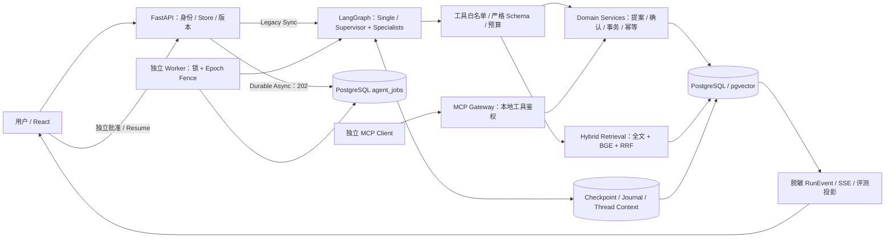

# AgentMall · 可恢复工作流与事务电商

AgentMall 将 **LLM 工具调用、可恢复 Agent 工作流与确定性电商事务**分开：模型可以检索、比较和准备提案；用户独立确认后，服务端才校验身份、版本与库存并提交业务。

**FastAPI · PostgreSQL 17 / SQLAlchemy · LangGraph · pgvector / 本地 BGE · React / TypeScript · MCP · Docker**

这是 AI Agent / Python 后端工程作品集。当前 **V2.14 Feature Freeze / 本地 Release Candidate**，没有生产用户量、真实支付或生产 SLA 声明。

[无Key Quick Start](docs/PORTFOLIO_DEMO.md#启动) · [5分钟演示](docs/DEMO_RECORDING_SCRIPT.md) · [架构](docs/ARCHITECTURE.md) · [能力/证据矩阵](docs/V214_RELEASE_CANDIDATE.md) · [面试讲解](docs/PORTFOLIO_INTERVIEW.md) · [发布清单](docs/RELEASE_CHECKLIST.md)

## 关键工程能力

| 能力 | 实际实现与边界 |
|---|---|
| Single / Multi-Agent | LangGraph Supervisor 动态路由至 Shopping / Order / AfterSales；服务端验证任务依赖、当前轮意图、工具批次和实体范围。保留 Single，不假设 Multi 更可靠。 |
| HITL 与事务 | 不可变 Proposal → 独立 Confirmation → 原 Run Resume；一笔多 SKU 订单、全部库存预留、确认消费和幂等回执同事务提交。购买不授权付款或退款。 |
| 多轮组合购物 | 13 品类 / 120 个合成 SKU；2–5 类 Bundle、整数分总预算、版本化候选、KEEP/REPLACE 等增量重规划。旧方案不是当前有效报价。 |
| 持久异步 Worker | Legacy Sync 与显式 Durable Async 并存；PostgreSQL 任务、Thread Advisory Lock、Epoch Fence、Node Journal 与官方 Checkpointer 协调恢复。不是通用 Exactly-Once。 |
| 实时进度 | fetch SSE 读取已提交 RunEvent，按 seq 补读/去重；JWT 仅在浏览器内存，断线不会重建订单或自动确认。 |
| 商家运营 | 本店订单/售后、草稿审核与动态上架、显式索引状态；Merchant Copilot 只读分析和说明草稿，不能替商家批准业务。 |
| 检索与评测 | PostgreSQL 全文检索 + BGE / pgvector + RRF；可选 CPU Cross-Encoder 默认关闭。Evaluation Studio 区分 Fixture、真实检索和历史 Live。 |
| MCP Gateway | 9 个角色受限工具；stdio / localhost HTTP 复用领域服务。唯一写扩展是待审核商品草稿；**REMOTE_AUTH_NOT_IMPLEMENTED**，没有交易执行工具。 |

## 系统架构



MCP 是外部工具接口，不是内部 Agent 工具的必经链路。Checkpoint 保存执行进度；领域事务决定订单、库存与授权是否真实生效。[完整职责和代码入口](docs/ARCHITECTURE.md)。

## Quick Start：默认无Key演示

需要 Docker、支持 `!override` 的 Compose v2 和可用本地端口；构建需下载锁定依赖，不下载模型权重。以下使用 Mac Docker Desktop，Linux 用户将显式 Context 换为自己核对的引擎。

```sh
# 仓库根目录；只使用本次新项目。先确认同名项目不存在、8026/5196空闲。
export COMPOSE_PROJECT_NAME=agentmall-v214-demo
# --env-file /dev/null 避免 Compose 自动读取本地 .env。
docker --context desktop-linux compose --env-file /dev/null \
  -f compose.ci.yaml -f compose.portfolio-local.yaml config --quiet
docker --context desktop-linux compose --env-file /dev/null \
  -f compose.ci.yaml -f compose.portfolio-local.yaml build runner
docker --context desktop-linux compose --env-file /dev/null \
  -f compose.ci.yaml -f compose.portfolio-local.yaml up -d --wait postgres
docker --context desktop-linux compose --env-file /dev/null \
  -f compose.ci.yaml -f compose.portfolio-local.yaml run --rm --no-deps \
  runner python scripts/demo.py --catalog-profile expanded --seconds 600
```

另开终端，按[场景设置](docs/PORTFOLIO_DEMO.md#场景设置)选择 `context-catalog`；打开 `http://127.0.0.1:5196`，合成账号 `buyer1` / `AgentMall-demo-2026!`，进入工作流创建 **Single Thread / Legacy Sync**：

1. `推荐300元以内的静音键盘，不要购买。`
2. `我改主意了，要支持无线连接的，预算提高到400元。`
3. `就买刚才推荐的第二款，一件，送演示宿舍。`

审阅快照后独立批准。自动化点击标记 **TEST_OPERATOR**；此默认路线到 **PENDING_PAYMENT** 为止，付款0。服务端与数据库真实运行，**SDK MockTransport + Fixture Embedding 不是 DeepSeek 实况，也不是真实 BGE**。普通 FastAPI 仍默认 `MODEL_DISABLED`；不要配置 Provider Key。测试控制接口只允许独占 localhost 演示。端口、故障检查和自有资源清理见[操作手册](docs/PORTFOLIO_DEMO.md)。


上图来自 V1 历史三轮 Demo：合成数据、MockTransport / Fixture、TEST_OPERATOR、未付款。它不是 V2.14 新录屏或 L7 成功证据；[来源与哈希](docs/evidence/portfolio-demo/verification.json)。**VIDEO_NOT_RECORDED**。

## Testing：按源码和执行范围归属

V2.14 的本轮实际命令、退出码、环境与日志 SHA 在[最终回执](docs/evidence/v214/verification.json)和[结果索引](docs/RESULTS.md)。本轮重新执行：**pytest 1220 passed / 14 skipped，Vitest 127，Playwright 119 / 0 retries**；Ruff、格式、TypeScript、ESLint与前端构建全部退出0。Linux aarch64，独占PG17/pgvector，SDK MockTransport / Fixture；14项原skip不变。本轮默认Single三轮浏览器Demo、独立SQL和官方Checkpoint另有新原件。

本轮实际构建使用可信本地依赖缓存、当前跟踪源码和锁文件同步；**标准基础镜像冷构建 NOT_RUN**，缓存缺依赖、浏览器定位与采集器字段的中途失败均记录于回执。

普通离线核心入口为 `uv run --project backend pytest --ci-offline-core`，必须先准备专属 PG17 / pgvector 与合成配置；前端为 `npm test` / `npm run test:e2e`。[测试/源码绑定](docs/V214_RELEASE_CANDIDATE.md#本轮离线验证)说明完整运行范围。

最近已发布远程 CI 是 [V2.5 Run42348866265 / Attempt1](https://github.com/Cockatoo-xlk/AgentMall-Portfolio/actions/runs/42348866265)，绑定 `c8e96835…`。当前完整累计版本 **REMOTE_CI_NOT_RUN_FOR_V214**；[历史 R8](https://github.com/Cockatoo-xlk/AgentMall-Portfolio/actions/runs/41972687787)也不能替代它。

## Real-LLM Evaluation：成功与失败分开

固定开发集五任务 × Single/Multi 的真实 Pilot 在 **`b5d6a685…`** 上为 **9/10（Single 5/5、Multi 4/5）**，56 次已结算请求，真实本地 BGE；高峰 Token 单价估算 ¥0.393226，**实际账单 UNKNOWN**。不是独立 Holdout，也不证明 Multi 生产可靠性。

| 后续 B2 / Multi 定向实验 | 源码 | 真实请求 | 结果 |
|---|---|---:|---|
| L1 | `342c3c19…` | 9 | PARTIAL：批次/重复派发 |
| L3 | `a055117f…` | 5 | PARTIAL：只读写权限/重复派发 |
| L5 | `d32d25b2…` | 12 | PARTIAL / BUDGET_EXCEEDED |
| L7 | `280ec908…` | 6 | PARTIAL / CONTEXT_SCOPE_VIOLATION；具体字段未保存 |

L6 离线完整 B2 为 11 次、批处理路径10次模型调用，仍保留两份独立确认；**L7 证明同源码真实 B2 尚未通过**。Oracle 的缺失目标/声明诊断不能直接等同于实际越权数据库写入。[完整来源、数据集哈希和证据分级](docs/V214_RELEASE_CANDIDATE.md#真实模型历史)。本轮不做 L8、不读取 Key、不进行真实请求。

## Limitations

- 没有真实支付/退款、云部署、生产负载、SLA 或灾难恢复保证。Worker 的 at-least-once 尝试不意味着外部模型请求 exactly-once。
- V2.10 语义实验是 Linux aarch64 / CPU、固定40条合成查询、单标注者；不能据此外推真实用户泛化或真实 LLM 优势。默认 Reranker 关闭。
- 当前 Multi B2 真实模型仍失败；Bundle、Copilot、MCP 的离线验证不能冒充真实 LLM 成功。模型别名 `deepseek-flash` 也不是不可变服务版本。
- R8 的 Journal 两字段直接快照、镜像/托管 Runner 最终物理销毁仍有历史证据限制；后续 Worker 测试不回写旧结论。
- 示例账户/密码和测试控制标签是公开合成配置，禁止当作公网部署认证。MCP 远程 OAuth 未实现。

## Documentation 与许可

[架构](docs/ARCHITECTURE.md) · [默认Demo](docs/PORTFOLIO_DEMO.md) · [面试六问](docs/PORTFOLIO_INTERVIEW.md) · [能力矩阵/发布计划](docs/V214_RELEASE_CANDIDATE.md) · [Release Checklist](docs/RELEASE_CHECKLIST.md) · [完整历史结果](docs/RESULTS.md)

[Bundle](docs/BUNDLE_SHOPPING.md) / [Replanning](docs/BUNDLE_REPLANNING.md) · [商家运营](docs/CATALOG_OPERATIONS.md) / [Copilot](docs/MERCHANT_COPILOT.md) · [MCP](docs/MCP_GATEWAY.md) · [Worker](docs/V212_DURABLE_WORKER.md) · [真实检索](docs/REAL_RETRIEVAL.md) · [Evaluation Studio](docs/EVALUATION_STUDIO.md)

原创内容采用 [MIT](LICENSE)，Copyright (c) 2026 Cockatoo-xlk。[权利人确认](docs/LICENSE_DECISION.md)、[第三方声明](THIRD_PARTY_NOTICES.md)、[版权边界](COPYRIGHT.md)与[公开快照](SNAPSHOT.md)继续有效；不分发模型权重、依赖二进制或镜像。[旧首页归档](docs/history/README-before-v214.md)保留历史工程记录。个人贡献及 AI 辅助范围按实际参与说明，不将代码量或测试数等同于独立贡献。
