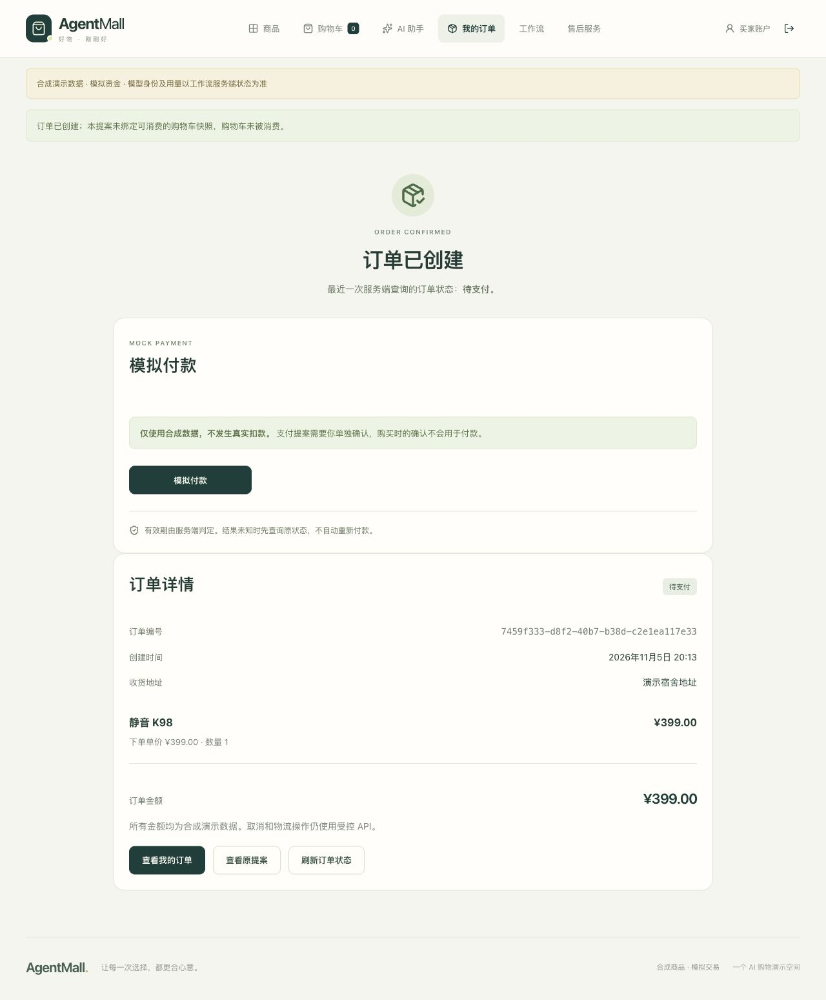
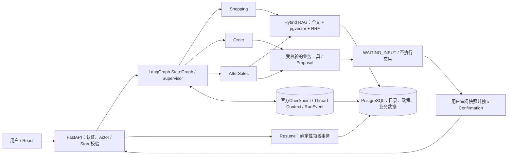

# AgentMall · 可恢复的购物 Agent 与事务电商

**FastAPI + PostgreSQL + LangGraph + Hybrid RAG + React / TypeScript**。将自然语言购物拆为商品检索、偏好更新、购买提案、独立确认与确定性订单事务，让“Agent建议了什么”和“系统实际执行了什么”能够分别核对。

用户可以在同一个Thread中说“300元以内静音键盘”，下一轮改为“400元、支持无线”，再选择**当前名单第二款**。服务端保存版本化偏好与候选绑定，重新核验商品后只准备提案；独立批准并Resume后才创建订单。

**[运行三轮Demo](docs/PORTFOLIO_DEMO.md) · [面试技术说明](docs/PORTFOLIO_INTERVIEW.md) · [架构细节](docs/ARCHITECTURE.md) · [本次浏览器结果](docs/evidence/portfolio-demo/verification.json)**

| 模式 | 可以证明什么 |
|---|---|
| 无Key作品集Demo | 页面明确显示 **SDK MockTransport**；Fixture Embedding、合成商品/账户，真实FastAPI、PostgreSQL、工具与Checkpoint。不是DeepSeek实况。 |
| 普通FastAPI | 默认 **MODEL_DISABLED**；启动API不等于启用模型。 |
| Live Playground | 已有ChatDeepSeek接入、工具协议与持久预算门禁；必须独立环境、授权、Key安全加载。当前T16真实多轮Pilot **NOT_RUN**。 |



截图为合成业务演示：**MockTransport + Fixture Embedding，确认操作者TEST_OPERATOR，未付款**。

## 核心能力

- **Multi-Agent**：Supervisor路由；Shopping检索商品，Order核验事实并准备购买，AfterSales处理资格、政策引用、售后与人工工单。保留Single模式，不假定Multi一定更优。
- **Thread上下文**：结构化SET / REPLACE / CLEAR、context_version；候选保存名单ID、稳定rank、Product ID与Catalog Version。偏好变化使旧名单失效，购买授权不跨Run继承。
- **Hybrid RAG**：PostgreSQL词法检索 + 固定BGE / pgvector向量召回 + RRF；店铺、价格、库存、状态与属性过滤在LIMIT前应用，工具重新读取当前事实。
- **HITL与恢复**：不可变Proposal → 独立Confirmation → 原Run Resume。官方PostgreSQL Checkpointer、RunEvent、节点Journal与Epoch Fence支持等待和恢复；JWT只存浏览器内存。
- **交易闭环**：购物车 → 确认下单 → 库存预留 → 订单详情独立确认模拟付款。购物车来源/版本由服务端绑定，创建订单时同事务安全消费；变化后的购物车保守保留，Agent直接下单不清理同SKU购物车。
- **商家运营工作台**：商家在 `/merchant` 处理本店订单和售后；模拟退款须核对快照，分别批准提案并执行。[操作与验证步骤](docs/MERCHANT_WORKBENCH.md)。
- **失败处理**：稳定request_id、action身份及幂等回执；响应未知先GET核对原结果。PARTIAL保留已完成业务，不用新随机请求盲目重做。

## 系统架构



模型只能调用白名单工具，不能自行批准购买、付款或退款。事务边界位于领域服务，Checkpoint保存图进度，不代替订单事务。详细实现：[工具及参数](backend/src/agentmall/agents/specialist_tools.py)、[持久图](backend/src/agentmall/agents/durable_graph.py)、[Run协调](backend/src/agentmall/agents/run_service.py)、[Thread Memory](backend/src/agentmall/agents/memory.py)、[交易服务](backend/src/agentmall/orders/service.py)。

## 本地运行：无Key三轮购物

需要Docker及支持`!override`的Docker Compose v2，仅使用新建、归属明确的项目。以下命令面向Mac Docker Desktop；其他引擎应替换为自己已确认的Context。先确认8026/5196空闲且没有同名旧项目，不停止未知服务、不复用历史数据库。

```sh
docker --context desktop-linux compose -p agentmall-portfolio-demo \
  -f compose.ci.yaml -f compose.portfolio-local.yaml config --quiet
docker --context desktop-linux compose -p agentmall-portfolio-demo \
  -f compose.ci.yaml -f compose.portfolio-local.yaml build runner
docker --context desktop-linux compose -p agentmall-portfolio-demo \
  -f compose.ci.yaml -f compose.portfolio-local.yaml up -d --wait postgres
docker --context desktop-linux compose -p agentmall-portfolio-demo \
  -f compose.ci.yaml -f compose.portfolio-local.yaml run --rm --no-deps \
  runner python scripts/demo.py --seconds 900
```

另开终端，按[健康检查与场景选择](docs/PORTFOLIO_DEMO.md#启动)启用已有`context-catalog` **MockTransport**场景。登录[网页](http://127.0.0.1:5196)，合成账号`buyer1` / `AgentMall-demo-2026!` → “工作流” → 创建Multi Thread，依次输入：

1. `推荐300元以内的静音键盘，不要购买。`
2. `我改主意了，要支持无线连接的，预算提高到400元。`
3. `就买刚才推荐的第二款，一件，送演示宿舍。`

查看提案后独立批准；自动化演示点击明确标记 **TEST_OPERATOR**。本场景仅生成待支付订单、付款0；完整[操作、截图、缓存构建备选与清理说明](docs/PORTFOLIO_DEMO.md)均已提供。数据库不发布宿主端口，测试控制API只能留在独占localhost演示中。不要配置Provider Key。

订单详情另有“模拟付款”，需要新的支付Proposal与Confirmation，与购买确认分开；所有资金均为合成数据，不发生真实扣款。普通购物车与Agent订单共用同一详情页。刷新后需重新登录，再用原Thread ID恢复，不能把浏览器导航引用当作权限。

## 已完成的工程验证

下表是 V1 的历史验收。R8 的 **CI/执行器提交为 `e60ee792d6809dad696f27aac1e40272dd04f141`，冻结产品提交为 `77b215878edbce50ce107c6e77e31de4d2044ff9`**。V2 商家工作台另做本地定向回归；历史结果不代表 V2 已通过完整远程 CI。

| 验证 | 结果 | 范围 |
|---|---|---|
| [R8 Run41972687787 / Attempt1](https://github.com/Cockatoo-xlk/AgentMall-Portfolio/actions/runs/41972687787) | pytest **834 passed / 14 skipped**，Vitest **85**，Playwright **96** | CI `e60ee792…` / 产品 `77b21587…`；Ubuntu24.04 x86_64 |
| 同Run专项Stage B | 真实固定BGE、512维CPU、14项检索、三轮Mock、独立PostgreSQL Oracle、Checkpoint、原900秒观察通过 | 真实检索与模拟模型分开；不是付费Live |
| 本次Mac浏览器Demo | 2→3件候选；预算300→400；TEST_OPERATOR批准后唯一待支付订单；付款0；刷新登录与Thread恢复通过 | SDK MockTransport + Fixture Embedding；[脱敏摘要](docs/evidence/portfolio-demo/verification.json) |
| 本次必要回归 | Demo启动器pytest **4 passed**；相关前端Vitest **16 passed** | 运行模式、上下文引用、工作流与时间线；不冒充全量新回归 |

14项skip仅13项真实BGE权重依赖和1项私有Live原件比较；真实BGE另由Stage B验证。旧失败没有删除：[T16-A3历史环境阻塞](docs/evidence/t16-a3/report.md)、[工程案例](docs/ENGINEERING_CASES.md)、[历史结果索引](docs/RESULTS.md)。本次未重复900秒CI、未增加skip/retry或放宽安全校验。

## 已知限制与后续工作

- MockTransport决定路由和工具请求，不能证明真实模型的多轮理解。当前T16真实多轮Live仍未运行；后续需独立环境、价格快照、持久费用预算和明确授权。
- T15-B1仅在旧提交`617cdf29`做过一个真实购物Smoke：7次Provider调用、50条事件、独立确认后唯一待支付订单、付款0；平台实际账单UNKNOWN。不能将其当作当前版本验收。[历史公开摘要](docs/evidence/t15-c/b1-public-summary.json)
- 两次历史真实开发集Pilot使用同五题：Single1/5→5/5、Multi4/5→4/5。40题已参与开发，不是独立Holdout，不能推导泛化提升或Multi总体优越性。
- Mac本地虚拟化曾有时钟回退与采样吞吐不足；原JWT与60/900秒合同未降低。本次短Demo不是新的Live环境准入。历史约1.91GiB环境的OOM/143、137均保留，不能称为完整单容器CI成功。
- Journal的node_journal/resume_journal直接字段快照不在R8冻结Oracle范围；镜像及托管Runner最终物理销毁UNKNOWN。图恢复不保证任意SIGKILL下外部模型调用exactly-once。
- 没有真实支付/退款、生产负载/SLA/灾难恢复验收或云部署。`VIDEO_NOT_RECORDED`；已提供截图及3—5分钟录制脚本。未来工作优先是获授权的真实多轮Pilot和面向使用者的交互优化。
- 本次限时停止未完成API临时Schema的优雅清理；业务原件保存后，专属PG和Volume等资源已删除并查无。内部停止原因UNKNOWN，不能将stop退出0当作清理证明。复现时按[专属清理步骤](docs/PORTFOLIO_DEMO.md#停止及清理)处理，不触及历史数据。

## 许可与贡献说明

原创内容采用[MIT](LICENSE)，Copyright (c) 2026 Cockatoo-xlk。第三方组件分别遵守[自身许可证](THIRD_PARTY_NOTICES.md)；[版权](COPYRIGHT.md)、[许可决定](docs/LICENSE_DECISION.md)与[公开快照边界](SNAPSHOT.md)可核查。公开仓库不包含原Private研发历史、原始Live账本、批准回执、模型权重或原始Checkpoint。

面试表述应按事实说明个人设计、实现、调试与AI辅助范围，不把仓库规模或测试数字等同于个人独立贡献。发布、Push、远程Actions及部署仍是独立操作，不由本地演示准备自动授权。
