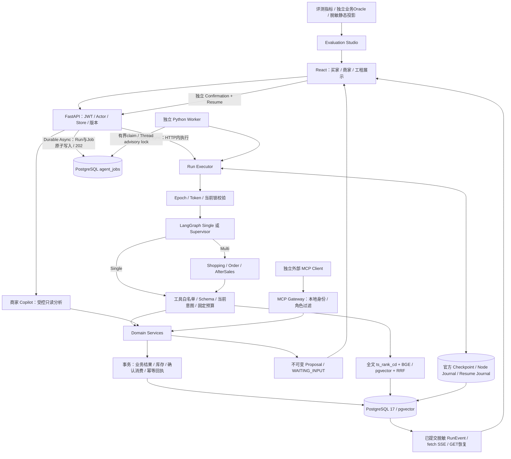

# 架构：模型建议、持久执行、领域事务

当前 V2.15 在 `main 71970c88d8827d22cd5626de20317a89d389bafc` / tree `50921e7431437e0603f6b59487dbbf6cf6e80ec6` 上做本地可靠性改进。产品改进已实现，验证汇总 **LOCAL_OFFLINE_VERIFIED**，真实 Provider、新 L8 Episode、远程 CI 均未在本轮运行。V2.14 Release **ON_HOLD**，V2.15 未发布。历史源码与验证身份见[历史结果](RESULTS.md)，L8结果见[评测报告](EVALUATION_RESULTS.md)。

## 两条执行路径与一个业务边界

MCP 是外部工具入口；内部 Agent 工具直接复用领域服务，并非全部经过 MCP。Checkpoint 记录图运行位置，事务与持久回执决定实际业务写入。HTTP 202 只证明接受/入队，`Run COMPLETED` 也不等于评测 PASS。

## 职责与源码入口

| 职责 | 实现 | 关键约束 |
|---|---|---|
| 请求接受与恢复 | [run_service.py](../backend/src/agentmall/agents/run_service.py)、[durable_graph.py](../backend/src/agentmall/agents/durable_graph.py) | 使用原 Run/Thread、请求身份；恢复须重新验证权限 |
| 异步调度 | [jobs.py](../backend/src/agentmall/agents/jobs.py)、[worker.py](../backend/src/agentmall/agents/worker.py)、[locking.py](../backend/src/agentmall/agents/locking.py) | Thread锁、epoch/token；队列时间戳不撤销实际数据库锁 |
| Checkpoint与Journal | [persistence.py](../backend/src/agentmall/agents/persistence.py)、[durable_graph.py](../backend/src/agentmall/agents/durable_graph.py) | 官方PostgreSQL Checkpointer；拒绝旧fence写入，恢复优先读原回执 |
| 当前意图与候选 | [context.py](../backend/src/agentmall/agents/context.py)、[memory.py](../backend/src/agentmall/agents/memory.py) | 结构化可信Context、版本化候选ID/rank、购买前重读当前事实 |
| 模型与工具边界 | [model_control.py](../backend/src/agentmall/agents/model_control.py)、[specialist_tools.py](../backend/src/agentmall/agents/specialist_tools.py)、[budgets.py](../backend/src/agentmall/agents/budgets.py) | 白名单、严格参数、整批写入顺序、依赖与预算；模型不能授予Actor/Store/批准 |
| 订单与库存 | [orders/service.py](../backend/src/agentmall/orders/service.py)、[actions/service.py](../backend/src/agentmall/actions/service.py) | 金额整数分、锁后重验、事务回滚、确认一次消费与幂等 |
| 售后与人工协助 | [aftersales/service.py](../backend/src/agentmall/aftersales/service.py)、[support/service.py](../backend/src/agentmall/support/service.py) | 资格和资源状态由服务端决定；建立Case不等于退款 |
| 商品发布与索引 | [catalog_operations/service.py](../backend/src/agentmall/catalog_operations/service.py)、[retrieval/ingest.py](../backend/src/agentmall/retrieval/ingest.py) | 草稿→审核→发布→独立索引；索引失败如实呈现 |
| MCP | [mcp_gateway/server.py](../backend/src/agentmall/mcp_gateway/server.py)、[domain.py](../backend/src/agentmall/mcp_gateway/domain.py) | 角色过滤、stdio/localhost；唯一写扩展为商品草稿，无付款退款工具 |
| SSE与界面 | [event_stream.py](../backend/src/agentmall/agents/event_stream.py)、[RunTimeline.tsx](../frontend/src/components/RunTimeline.tsx) | 已提交事件按seq补读/去重；JWT在内存与Authorization头中 |

## 一次购买的顺序

1. FastAPI 从认证结果建立可信 Actor / Store，保存请求、Run 和 Context；Durable Async 同事务保存 Job。
2. Executor / Worker 获取原 Thread advisory lock，并建立当前 epoch/token；Journal、Checkpoint 与受保护写入检查 fence。
3. 模型检索、选择工具并生成不可变 Proposal。`WAITING_INPUT` 时订单尚未创建，模型文本不能当确认。
4. 用户独立提交 Confirmation，再 Resume。交易服务锁定提案/确认及排序后的商品行，重验所有权、期限、当前版本、价格、库存。
5. 订单、OrderItem、全部库存预留、确认消费与幂等回执共同提交或回滚。响应丢失后按原请求读取持久回执，不用新购买请求“恢复”。
6. RunEvent 提交后才可由 SSE/GET 读取。刷新、重连、重登仅恢复显示，不自动新建 Run、批准或下单。

购买批准只覆盖该购买提案；付款、退货、退款必须走各自权限与确认协议。进程故障、模型响应丢失与外部网络副作用仍有独立证据边界，系统不提供通用 exactly-once。[故障测试](../backend/tests/test_commit_then_crash.py)、[恢复交错](../backend/tests/test_recovery_interleavings.py)。

## V2.15可靠性改进的落点

| 问题 | 当前工作入口 | 验证状态 |
|---|---|---|
| 比较有线/无线被当作唯一连接约束；推荐数量不足仍可能结束 | [product_preferences.py](../backend/src/agentmall/agents/product_preferences.py)、[graph.py](../backend/src/agentmall/agents/graph.py)、[推荐回归](../backend/tests/test_v215_recommendations.py) | 已实现 / LOCAL_OFFLINE_VERIFIED |
| “采购”、商品量词、退货提案、人工客服工单未稳定映射当前意图 | [purchase_intent.py](../backend/src/agentmall/agents/purchase_intent.py)、[request_intents.py](../backend/src/agentmall/agents/request_intents.py)、[意图回归](../backend/tests/test_v215_request_intents.py) | 已实现 / LOCAL_OFFLINE_VERIFIED |
| 当前提案的执行/拒绝状态容易与模型总结混淆 | [goal_receipts.py](../backend/src/agentmall/agents/goal_receipts.py)、[状态观察回归](../backend/tests/test_v215_goal_receipts.py) | 已实现 / LOCAL_OFFLINE_VERIFIED；观察不是授权 |
| 正式Run的SDK事件增加有界安全关联元数据 | [model_diagnostics.py](../backend/src/agentmall/infra/model_diagnostics.py)、[model_control.py](../backend/src/agentmall/agents/model_control.py)、[诊断回归](../backend/tests/test_v215_model_diagnostics.py) | 已实现 / LOCAL_OFFLINE_VERIFIED |
| 用户反馈应区分步骤失败与已有业务回执 | [失败反馈回归](../backend/tests/test_v215_failure_feedback.py)、[两次确认/故障工作流回归](../backend/tests/test_v215_workflow.py)、[runFailure.ts](../frontend/src/api/runFailure.ts) | 已实现 / LOCAL_OFFLINE_VERIFIED |

款数与连接比较的完成检查仅应用于推荐只读场景：存在purchase、return或bundle目标时不进入该短缺检查，继续使用各自原完成语义。有界中文规则遇到矛盾、未决条件或无法唯一归属的数量时要求澄清，不表示任意自然语言已获支持。

这些是新版本的合成回归与正式产品工程工作，不修改 L8 冻结 Executor、Host、Schema、Gold、Oracle、历史 Ledger 或原任务评分。08号根因仍 `INSUFFICIENT_EVIDENCE`，新观测字段不能补写历史原件。

## 正式Run模型诊断的证据边界

[诊断模块](../backend/src/agentmall/infra/model_diagnostics.py)通过ContextVar为每次 `model_control.model_call` 建立独立receipt，并在finally恢复上层Context；公开事件经[白名单投影](../backend/src/agentmall/infra/observability.py)后持久化。模型/工具参数、Prompt、响应正文、凭据均不进入该诊断投影。

| 字段 | 实际来源与含义 | 证据限制 |
|---|---|---|
| `model_request_id` | 每次调用本地生成的UUID4，32位hex；关联model_start/model_end | 不是Provider发出的ID、HTTP请求回执或授权 |
| `tool_schema_sha256` | 实际SDK payload的tools数组，经排序键、紧凑UTF-8 JSON规范化后取SHA256；版本标签为V215_TOOL_SCHEMA_V1 | 不含Prompt；不是历史实际wire Schema原件 |
| `response_body_sha256` | SDK response.model_dump()/dict按同一JSON规则规范化后取SHA256 | **不是原HTTP响应字节哈希**，不证明完整wire内容原样保留 |
| `provider_response_id` | 经过格式/敏感模式过滤的响应body.id | **不是HTTP request-id header**；无法证明账单结算 |
| `provider_usage_state` / `observed_provider_usage` | UNKNOWN、INVALID或OBSERVED_VALID；后者只表示数字为有界非负整数、input+output=total并符合本次输出cap | 是响应观察，不是独立真实性认证、Ledger结算或供应商账单 |
| `output_budget_state` | 本地输出预算核对状态RECONCILED或UNRESOLVED | 不是供应商消费状态；观察有效不自动释放未核对的预留 |
| `diagnostic_stage` | 有界阶段枚举，区分SDK请求构建与响应解析失败 | SDK响应解析异常归一为MODEL_RESPONSE_INVALID，不导出异常正文 |

该捕获覆盖正式Run的Supervisor、Durable Single/Multi等 `model_call` 路径。旧 [single_agent.Guard](../backend/src/agentmall/agents/single_agent.py) 入口不在新捕获范围，继续原处理。原DurableBudget持久事件使用同一Fence、model_event_key和NodeStore去重协议；没有新Provider重试、Key读取或结算入口。[合成诊断测试](../backend/tests/test_v215_model_diagnostics.py)与[后续解析失败仍保留Case回执测试](../backend/tests/test_v215_workflow.py)是独立新回归，不重播L8原题。

## 检索、评测与复现

目录经过内容哈希和版本化索引，使用 Jieba、PostgreSQL `ts_rank_cd` 全文检索、本地BGE512与pgvector，再以RRF融合；它不是BM25。Store、状态、预算、属性和库存过滤先于LIMIT；最终重读商品及索引版本。可选 CPU Cross-Encoder 默认关闭。[真实检索实验与限制](REAL_RETRIEVAL.md)。

Thread Context 保存偏好、候选集合ID、稳定rank、SKU及版本；Bundle 保存品类独立约束与整套预算。旧候选不是当前报价。Evaluation Studio 消费静态脱敏投影，保留来源SHA、计划分母与未知值，页面能加载不意味着当前模型已通过。

依赖由 [uv.lock](../backend/uv.lock) / [package-lock.json](../frontend/package-lock.json)锁定。默认[无Key演示](DEMO_GUIDE.md)使用 MockTransport / Fixture，不分发模型权重、不配置真实Provider Key。CI的后端、前端与严格release gate由[workflow](../.github/workflows/ci.yml)定义；是否实际通过必须对应准确源码与新回执。
