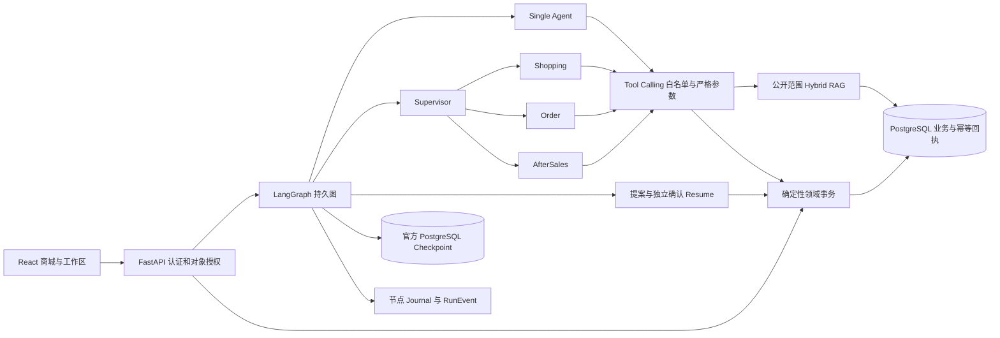

# 实际架构与数据职责

本页依据公开源码说明技术实现；原研发设计与各阶段实测范围以对应历史证据为准。

- [订单事务](../backend/src/agentmall/orders/service.py)：锁后重验价格/版本/库存/数据库时间，价格整数分。待支付订单预留库存，退款不自动回补。
- [确认](../backend/src/agentmall/actions/service.py)与[Resume](../backend/src/agentmall/agents/resume.py)：登录主体、店铺、提案、interrupt和confirmation绑定；第一份确认不能批准第二份提案。
- [持久化](../backend/src/agentmall/agents/persistence.py)与[Run服务](../backend/src/agentmall/agents/run_service.py)：同Thread锁、Epoch Fence、节点Journal和业务回执协调。Checkpoint与业务事务分别提交。
- [工具边界](../backend/src/agentmall/agents/specialist_tools.py)：模型不能注入Actor/Store、确认、退款金额或直接SQL；混合写入批次整体拒绝。
- [检索](../backend/src/agentmall/retrieval/search.py)：词法/向量召回以RRF合并；公开范围、店铺、政策版本和实体当前状态由服务器验证，引用不覆盖领域资格。
- [Trace](../backend/src/agentmall/infra/observability.py)：RunEvent的白名单投影，无原始对话或思维链，导出器失败不回滚已完成合法业务。

Python依赖以[uv.lock](../backend/uv.lock)、前端以[package-lock](../frontend/package-lock.json)为准。迁移在[backend/migrations](../backend/migrations)，API以实际[路由源码](../backend/src/agentmall/main.py)与运行时OpenAPI为准。

默认Demo给图注入明确标记的Fixture Model；普通FastAPI不注入模型。独立[Live Playground](LIVE_PLAYGROUND.md)在新授权、源码/价格/环境/BGE门禁之后注入真实ChatDeepSeek，发送前由独立持久账本预留预算。Fixture、SDK MockTransport和Live身份由认证后的服务端runtime返回，不由浏览器变量决定。

购物车来源/版本绑定于服务端不可变快照，成功创建订单时与库存预留一起事务消费未变化的购物车；独立商品提案不消费购物车。订单详情通过另一份支付提案与Confirmation模拟付款。提案倒计时只辅助展示，服务器数据库时间、身份与版本检查始终决定能否执行。
