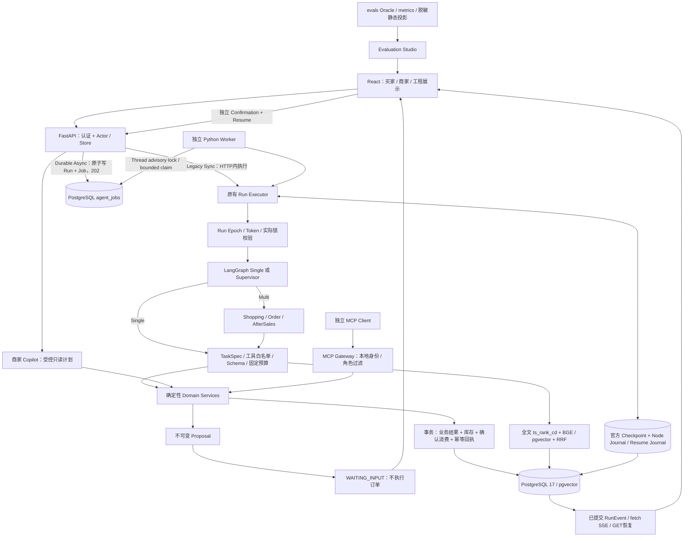

# 架构：模型决策、持久执行、领域事务

## 当前状态追加：V2.14-R4（2026-11-10）

V2.14产品已通过PR #2合并main **`59f84ebbfdfb1d87287ad6c4ae83a1748183d30c`**；[main Push CI / Attempt1](https://github.com/Cockatoo-xlk/AgentMall-Portfolio/actions/runs/42770031624) 的Backend、Frontend、Release Gate全部success，原始日志核验pytest **1291 passed /14 skipped**、Vitest **127**、Playwright **119 /0 retries**。具体身份、源码树和三个Artifact SHA见[post-merge回执](evidence/v214-r4/verification.json)。这些是main CI成绩，不是本轮重新运行全量回归。

本轮仅更新发布文档，仍待独立文档PR；建议版本`v2.14.0`尚无Tag/GitHub Release。没有生产部署或真实付款，真实L7 B2仍PARTIAL。下文原阶段的NOT_RUN、cancelled、pending或“本轮”字样保留历史含义，不覆盖本节最新状态，不代表旧失败被改写。

下文架构和代码入口仍对应同一产品源树；MCP不是内部工具的必经链路，Checkpoint不替代业务事务，异步202不代表业务成功。R4没有修改Agent、交易、Worker或检索代码。

---

V2.14 只整理已有系统，不新增角色或架构。入口与模式以服务端实际配置为准；普通 `agentmall.main` 默认 MODEL_DISABLED，下面的无Key演示使用 MockTransport。

## 执行与授权边界

| 职责 | 代码入口 | 不承担的职责 |
|---|---|---|
| 接受/恢复 Run | [run_service.py](../backend/src/agentmall/agents/run_service.py)、[durable_graph.py](../backend/src/agentmall/agents/durable_graph.py) | HTTP 202 不等于业务成功；同步 POST 未结束也可独立读 Run/SSE |
| 异步调度 | [jobs.py](../backend/src/agentmall/agents/jobs.py)、[worker.py](../backend/src/agentmall/agents/worker.py) | 队列时间戳不是撤销实际 Thread 锁的租约；不提供通用 exactly-once |
| 图状态与恢复 | [persistence.py](../backend/src/agentmall/agents/persistence.py)、[run_service.py](../backend/src/agentmall/agents/run_service.py) | Checkpoint 不替代业务事务，旧 epoch 不能凭旧快照写入 |
| 工具校验 | [model_control.py](../backend/src/agentmall/agents/model_control.py)、[specialist_tools.py](../backend/src/agentmall/agents/specialist_tools.py) | 模型不能传 Actor/Store/批准，非法写批次整体拒绝 |
| 订单与库存 | [orders/service.py](../backend/src/agentmall/orders/service.py)、[actions/service.py](../backend/src/agentmall/actions/service.py) | 不相信模型价格；不把购买批准用于付款或退款 |
| 商家发布与索引 | [catalog_operations/service.py](../backend/src/agentmall/catalog_operations/service.py)、[retrieval/ingest.py](../backend/src/agentmall/retrieval/ingest.py) | 草稿不能直接上架；索引失败不回滚合法发布，也不谎称可检索 |
| MCP | [mcp_gateway/server.py](../backend/src/agentmall/mcp_gateway/server.py)、[domain.py](../backend/src/agentmall/mcp_gateway/domain.py) | 不是内部 Agent 工具必经路径；localhost Bearer 不是完整远程 OAuth |

## 持久化与交易顺序

1. 接受请求时保存原 request_id、可信 Context 和 Run；异步模式在同一接受事务加入 Job。
2. Executor / Worker 获取原 Thread advisory lock，更新 epoch/token。Journal、Checkpoint 和受保护写操作验证当前 fence。
3. Agent 只选择工具并准备不可变提案；独立 Confirmation 之后才进入确定性执行节点。
4. 订单锁定提案/确认及按 UUID 排序的商品行，重验当前版本、价格、库存、期限。订单、OrderItem、全部库存预留、确认消费与幂等回执共同提交或回滚。
5. Node Journal 保存已提交节点结果，官方 Checkpointer 保存图位置。Commit 后响应丢失先读取原业务回执；恢复不是用新请求重新购物。

Single 与 Multi 共享领域服务、HITL 与预算；Multi 有额外交接开销。L6 只有在整批可信只读回执齐备后使用 SDK 现有结束边，写提案仍由模型选择。完整 B2 需要退货与购买各一份独立确认。[L6离线报告](evidence/v213-l6/report.md)与[L7真实失败](V214_RELEASE_CANDIDATE.md#真实模型历史)不能混为一谈。

## 检索、版本和界面

目录 → 版本化文档/内容哈希 → Jieba 词法分词 + 本地 BGE512 → PostgreSQL 全文 / pgvector → RRF。词法使用 `ts_rank_cd`，**不是 BM25**。Store、状态、预算、属性、库存过滤先于 LIMIT；最终重读商品与索引版本。可选 Reranker 默认关闭。[真实检索范围](REAL_RETRIEVAL.md)。

Thread Context 保存偏好、候选集合ID、稳定rank、SKU与版本；Bundle保存品类独立约束、整套预算和来源版本。重规划只检索受影响品类，其余仍重读当前事实；候选缓存不是报价或授权。

[SSE](../backend/src/agentmall/agents/event_stream.py)读取已提交的脱敏 RunEvent，有限连接窗口与心跳，客户端按 seq 恢复/去重。JWT 只在内存和 Authorization 头中；退出登录取消流。重连只读，不新建Run、批准或重复订单。

[Evaluation Studio](EVALUATION_STUDIO.md)消费既有 evals 的只读静态投影，保留计划分母、UNKNOWN / NOT_APPLICABLE；Fixture、历史真实BGE与真实LLM分开归属。Merchant Copilot 只生成受引用约束的分析/说明，不能执行商家写操作。

## 复现与证据限制

依赖由 [uv.lock](../backend/uv.lock) / [package-lock.json](../frontend/package-lock.json)锁定，迁移当前到0011。模型权重和私有配置不进Git。默认Demo通过现有测试入口注入MockTransport/Fixture，只在独占loopback开放。[能力矩阵](V214_RELEASE_CANDIDATE.md)、[真实命令/日志SHA](evidence/v214/verification.json)、[历史结果](RESULTS.md)分别说明验证范围。

Worker验证覆盖受控进程故障与原业务幂等，不表示生产SLA、任意外部调用Exactly-Once或云端灾备已验收。MCP为 **REMOTE_AUTH_NOT_IMPLEMENTED**；当前Multi B2真实测试仍失败。
