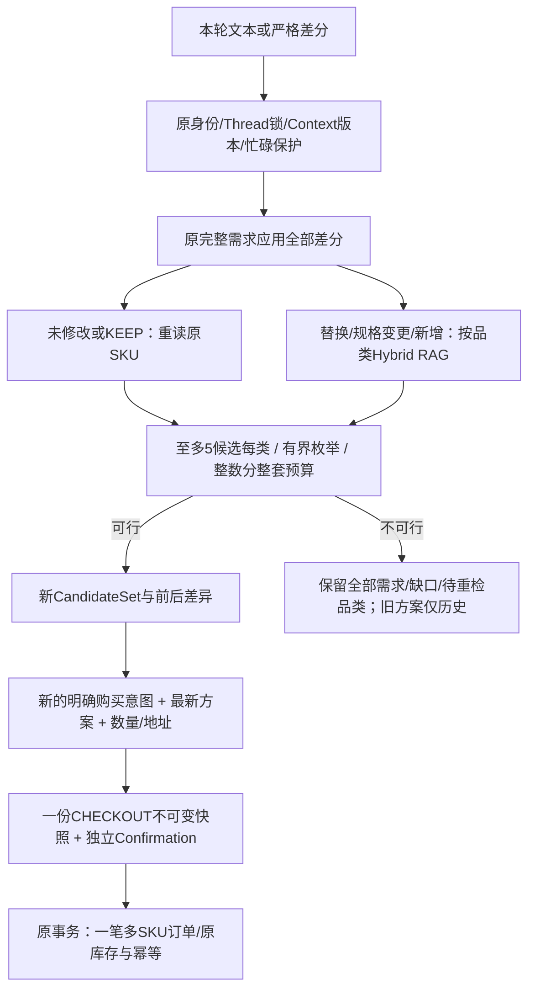
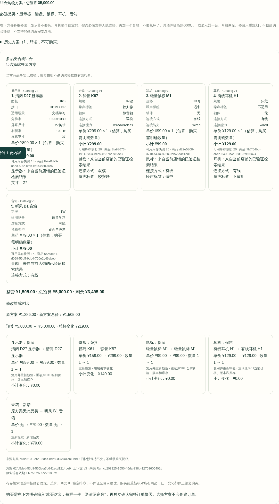

# V2.9：同一Thread内的组合重规划

在[原Bundle购物](BUNDLE_SHOPPING.md)上增加可信差分，继续使用Shopping/Order、CandidateSet、Thread Context、官方Checkpoint和原多SKU事务。修改不代表购买，历史方案和旧Confirmation都不能授予新订单权限。

## 3—5分钟Mock演示

复用[原Bundle指南的独占Compose启动方式](BUNDLE_SHOPPING.md#三分钟离线演示)，替换为自己的新项目名、空闲端口和本分支源码；不要复用历史数据库/Volume。设置既有`/__test/sdk-mode`为`bundle`，此入口只允许localhost合成演示。模型 **MockTransport**，Embedding **Fixture**；不是DeepSeek或真实语义质量验收。

1. 用合成buyer1登录工作流，创建Multi Thread。输入：`预算5000元，帮我搭配一套居家办公设备，包括27英寸显示器、键盘、鼠标和耳机。先推荐，不要购买。` 核对4个品类、总预算和当前方案ID；提案/订单0。
2. 在本次任务框输入：`显示器不要换，键盘必须支持无线连接，再加一个音箱。` 看SSE中的重验/重新检索与重规划事件。仅键盘和音箱调用Hybrid RAG，其他品类重新读取原SKU。对比中查看真实名称、单价、数量、小计、总金额和预算；5个必选品类保留。方案选择按钮用于后续购买，修改前保持未选中。
3. 可继续输入：`耳机换个便宜的。` 或`不要鼠标了。`、`显示器一台，耳机两副。`。更便宜必须严格低于原单价；若当前候选池没有合格商品，就显示缺口，不能用不存在的折扣或删除需求兜底。原方案已经可能是候选池最便宜，因此不保证一定有更便宜的替代品。
4. 刷新、重新登录，同Thread恢复最新方案与最多20份只读历史。未完成的重检义务会跨失败重规划保存；降低预算至无方案后可提高预算继续调整，历史方案仍不可购买。
5. 明确选择当前方案，输入：`就买修改后的这套，每样一件，送演示宿舍。` WAITING_INPUT时核对全部SKU不可变快照，再独立批准。浏览器自动化操作者为 **TEST_OPERATOR**；只生成一笔PENDING_PAYMENT订单，付款0。不点击模拟付款。

只读查看现有Thread/历史，不会自动创建Run、重检、批准或Resume。断线补读使用原SSE的seq，刷新恢复使用原GET。若已有WAITING_INPUT，须先明确拒绝或等待提案过期，再走新的合法流程；修改不会改写旧提案。

## 七种结构化操作

原POST `/api/v1/agent/threads/{thread_id}/runs`增加可选`bundle_revision`。身份来自原认证，Store/Thread归属服务端核验。外层`expected_context_version`与内层版本必须匹配当前Context，source只能是当前明确方案，或失败后服务端保留的同一修订来源；不能用任意历史ID。

```json
{
  "request_id": "<本次操作的新UUID，响应丢失时复用>",
  "message": "应用组合修改",
  "expected_context_version": 2,
  "bundle_revision": {
    "source_bundle_id": "<刚才实际展示的bundle_id>",
    "expected_context_version": 2,
    "operations": [
      {"operation_type": "KEEP", "target_category": "monitor"},
      {"operation_type": "REPLACE", "target_category": "headphones", "cheaper": true},
      {"operation_type": "SET_CONSTRAINT", "target_category": "keyboard", "new_constraints": {"connection": "无线"}}
    ]
  }
}
```

占位符不是可直接执行的UUID，版本也必须读当前值。结构化操作使用固定中性输入`应用组合修改`或`按结构化参数修改组合`；若同时提供有意义的自然语言，必须能被完全解析且与操作一致，未知硬约束仍澄清。

| 操作 | 字段与规则 | 受控中文示例 |
|---|---|---|
| KEEP | target_category；绑定原具体SKU，不冻结旧价格 | 显示器不要换 |
| REPLACE | target_category，cheaper可选；排除原SKU，保留其余硬约束 | 耳机换个便宜的 / 耳机换一个 |
| SET_CONSTRAINT | target_category、非空new_constraints；只改提供字段 | 键盘必须支持无线连接 / 显示器改成27英寸 |
| ADD | 新target_category，new_constraints/1–10数量可选；总品类最多5 | 再加一个音箱 |
| REMOVE | 已存在target_category；总品类至少2 | 不要鼠标了 |
| UPDATE_BUDGET | budget_cents为正整数分，最多100000000分 | 总预算提高到6000元 / 预算降低到3000.50元 |
| UPDATE_QUANTITY | requested_quantity严格整数1–10；target_category省略表示全部 | 显示器一台，耳机两副 |

new_constraints只允许既有ProductQuery的连接、静音、屏幕尺寸、用途、单价上限、布局、键盘类型、骑行用途、商品类型及排除双/三模标签。禁止query/category/in_stock/Store等绕过字段，不能隐式用null清除硬条件。多项冲突、重复预算、缺少对象、未知硬要求、数量越界、加到6品类或删到1品类都在事务提交前拒绝。预算和数量文本必须带各自单位，元用Decimal转整数分，不使用浮点金额。

普通购买仍使用原`bundle_id/bundle_quantities`，数量和地址来自本轮明确输入。不能把revision请求与购买、提案批准混在一起。

## 增量检索与状态



每类最多5件、最多3125种候选组合。保留静音偏好优先、总价、Product UUID的原稳定排序，不宣称全目录最优。总预算或数量变化不触发无条件全品类检索；复用的单SKU仍重新检查本店、当前上架、可用库存、规格、价格和版本。失效原SKU不能偷偷换成其他商品，必须显示缺口或明确要求替换。

差分记录source_bundle_id、操作、原/新总价及预算、每品类保留/替换/新增/删除/未解决、前后事实和重检原因。无方案时新总价/变化量为null，界面显示未知，不能当0。失败修订保留待刷新品类，后续仅调预算也会继续完成其重检。Context版本与Run快照沿用原持久化边界，无新增表、授权字段或后台任务系统。

新增持久化事件：bundle_revision_requested、bundle_constraints_updated、bundle_retrieval_reused、bundle_retrieval_refreshed、bundle_replanned、bundle_revision_rejected。仅投影允许的品类、状态、数量和金额，无原始Prompt/隐私。事件沿用节点Journal/Checkpoint的既有提交边界，不宣称每次检索内部逐token实时推送。

## 验收与限制

[实际本地回归与A—L映射](evidence/v29/report.md) · [命令与日志SHA](evidence/v29/verification.json)。不把历史远程CI或真实Live结果充当本版本验收。当前受控语言并非无限开放理解，不支持的表达明确澄清；最新方案有原15分钟有效期，商品变化时必须重新报价。

实际浏览器中的修改前后对比（MockTransport / Fixture Embedding、合成商品；后续确认操作者TEST_OPERATOR）：


