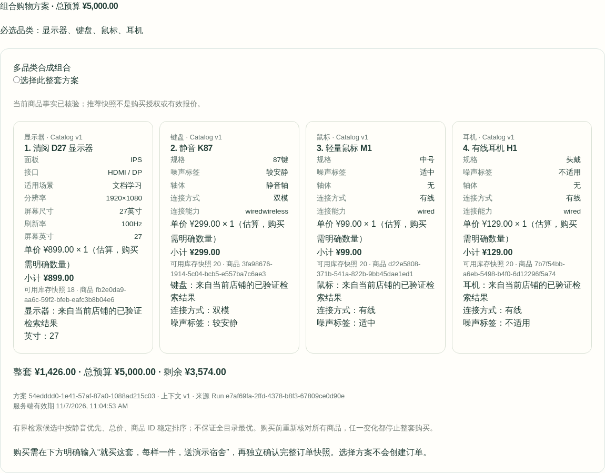
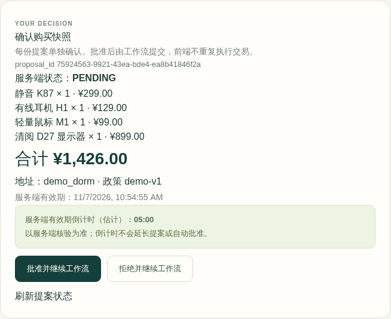

# V2.6：跨品类组合购物

支持同一买家、同一店铺、2–5个不同品类、每类一个SKU、一项整套预算。它是 Shopping 的多次真实检索与确定性组合计算，随后由 Order 准备一份多SKU提案；不是批量购物车按钮，也不增加新Agent。

## 三分钟离线演示

复用[现有Compose启动器](PORTFOLIO_DEMO.md)，但本例采用新的项目、镜像tag、端口与输出目录。先确认下面项目/Volume不存在，端口空闲；若已存在，停止并核对归属，不能直接覆盖历史实例。

```sh
docker --context desktop-linux ps -a --filter label=com.docker.compose.project=agentmall-v26-demo
docker --context desktop-linux volume ls --filter label=com.docker.compose.project=agentmall-v26-demo
lsof -nP -iTCP:8029 -iTCP:5199 -sTCP:LISTEN
mkdir -p .playground/v26-demo/output
cat > .playground/v26-demo/compose.override.yaml <<'YAML'
services:
  runner:
    image: agentmall-v26-demo:local
    volumes: !override
      - ./.playground/v26-demo/output:/work/.t13/outputs
YAML
export AGENTMALL_DEMO_API_PORT=8029 AGENTMALL_DEMO_WEB_PORT=5199
docker --context desktop-linux compose --env-file /dev/null -p agentmall-v26-demo \
  -f compose.ci.yaml -f compose.portfolio-local.yaml -f .playground/v26-demo/compose.override.yaml config --quiet
docker --context desktop-linux compose --env-file /dev/null -p agentmall-v26-demo \
  -f compose.ci.yaml -f compose.portfolio-local.yaml -f .playground/v26-demo/compose.override.yaml build runner
docker --context desktop-linux compose --env-file /dev/null -p agentmall-v26-demo \
  -f compose.ci.yaml -f compose.portfolio-local.yaml -f .playground/v26-demo/compose.override.yaml up -d --wait postgres
docker --context desktop-linux compose --env-file /dev/null -p agentmall-v26-demo \
  -f compose.ci.yaml -f compose.portfolio-local.yaml -f .playground/v26-demo/compose.override.yaml \
  run --rm --no-deps runner python scripts/demo.py --catalog-profile expanded --seconds 600
```

最后一个命令保持前台运行。打开`http://127.0.0.1:5199`，API为`http://127.0.0.1:8029`；数据库不发布宿主端口。另开终端，在此专属Demo API上切换受控模型程序：

```sh
curl --fail --silent --show-error -X POST http://127.0.0.1:8029/__test/sdk-mode \
  -H 'Content-Type: application/json' -H 'X-E2E-Key: agentmall-local-e2e' \
  --data '{"program":"bundle"}'
```

停止后保存自己所需的合成演示记录，再仅清理这个新项目及其Volume；不要使用全局prune，也不要替换为历史项目名：

```sh
docker --context desktop-linux compose --env-file /dev/null -p agentmall-v26-demo \
  -f compose.ci.yaml -f compose.portfolio-local.yaml -f .playground/v26-demo/compose.override.yaml down --volumes --remove-orphans
docker --context desktop-linux ps -a --filter label=com.docker.compose.project=agentmall-v26-demo
docker --context desktop-linux volume ls --filter label=com.docker.compose.project=agentmall-v26-demo
```

测试控制入口只用于loopback合成演示，不能暴露公网。页面必须显示 **MockTransport**；本路线使用 **Fixture Embedding**、120件合成商品、真实FastAPI/PostgreSQL/pgvector/LangGraph与官方Checkpoint。真实Provider请求0、Key读取0，不代表真实模型能力或真实BGE质量验收。

1. 登录合成`buyer1`，进入Agent Workspace，选择Multi并创建Thread。
2. 输入：`预算5000元，帮我搭配一套居家办公设备，包括27英寸显示器、无线键盘、鼠标和耳机。先推荐，不要购买。`
3. 看SSE中的四次品类检索与“组合预算计算”。核对完整组合、每件规格/价格/数量、总价与剩余预算。此时提案0、订单0。刷新重登仍可读同一方案。
4. 输入：`就买这套，每样一件，送演示宿舍。` 若有多个方案，先明确选择一个。模型只能使用服务端绑定的bundle_id，不能替换SKU。
5. WAITING_INPUT时查看全部SKU的不可变订单快照与有效期。亲自批准后，Resume创建唯一PENDING_PAYMENT订单。自动化截图中的确认身份是 **TEST_OPERATOR**。
6. 查看订单详情、Run时间线和历史Thread；不执行模拟付款。重复刷新或原Resume重放不新增订单。

只推荐的示例截图（MockTransport + Fixture Embedding，合成数据）：



独立确认界面（截图操作者TEST_OPERATOR；未付款）：



## 任务与组合算法


- `BundleRequirements`包含整套`budget_cents`和2–5个唯一`BundlePart`。每项独立携带品类、规格、数量与可选静音优先偏好；屏幕尺寸和无线条件不传播到其他品类。
- 服务端从当前用户文本或明确结构化输入解析需求。无法表达、缺失总预算、矛盾价格/尺寸/数量、未知规格均要求澄清，不由模型猜测。MVP支持明确品类、英寸、连接、静音、办公/游戏/宿舍用途与单项价格上限；复杂比较性/兼容性约束尚不支持。
- `retrieve_bundle_candidates(category)`仅接受当前任务中的品类。原Hybrid RAG保留0.45阈值、RRF、店铺/价格/属性/状态/库存/版本过滤及事实重读。模型不能传入放宽的过滤器。
- 从每类最多5条事实中枚举，最大5⁵=3125组；按显式静音优先惩罚、整套价格、顺序Product UUID稳定排序。所有金额为整数分。只保证检索池内按此规则选择，不声称全目录全局最优。
- 无候选或整套预算不足时保留全部必选品类，返回缺口；不会购买剩余部分。未指定数量的推荐按每样1件估算并显著标记，**购买当轮必须明确数量**或传入完整`bundle_quantities`。
- 预算单独调整可发新Run；其他规格改变需重新明确完整组合需求。UI可清除组合再开始单商品任务。旧方案不因重放延长有效期。

## 持久化与安全边界

迁移`0009`为既有`agent_candidate_sets`增加`kind=product|bundle`和对象型`details`。历史行默认product，原12 SKU/UUID与Legacy默认Seed不变。存在bundle快照时拒绝有损downgrade，需单独数据迁移。

组合保存所属Thread/Run/买家/Store、上下文版本与偏好摘要、各SKU的价格/属性/版本/数量、整套预算/金额、内容哈希和服务端有效期。Thread查询只读核验当前商品；更换偏好、过期、价格/属性/版本/状态/库存变化使旧方案无效。澄清更新需求时清除旧池与组合，并通过Checkpoint delta传播删除，防止旧READY误充新目标完成。

`prepare_bundle_checkout(bundle_id)`无模型SKU列表或数量参数。服务器要求当前轮购买意图、唯一当前方案、明确数量和地址；拒绝文字与结构化输入冲突、追加未表达的硬限制、越权/未选SKU及过预算。提案在一个事务内生成，并比较全部商品/属性/数量/版本/价格和总价，任一差异回滚。

原订单领域服务未修改：按UUID排序锁全部SKU，全部校验后才预留库存，并将订单、OrderItem、Confirmation消费和幂等回执同事务提交。一个SKU失败不产生部分订单或其他库存预留。一份Confirmation只批准这一份整套提案，付款仍需另一份独立授权。

保持原模型/工具/委派预算、HITL、Epoch Fence、Node Journal、官方Checkpoint及GET/SSE恢复。组合只复用已存在的Shopping/Order职责，不在模型文本中信任业务结果。

## 验证与限制

[本轮结果及原始日志哈希](evidence/v26/verification.json)与[场景/失败记录](evidence/v26/report.md)绑定本次文件指纹。浏览器测试使用TEST_OPERATOR，数据库逐项核对订单、库存、Confirmation、幂等、事件和Checkpoint。没有真实支付、跨店铺组合、运费/促销或性能最优性证明。

当前V2.6真实DeepSeek/真实多轮Live **NOT_RUN**；旧版本Live与V2.5远程CI不替代本轮结果。本轮没有Push或远程CI，也不重复T16的900秒门禁。录屏未制作。
