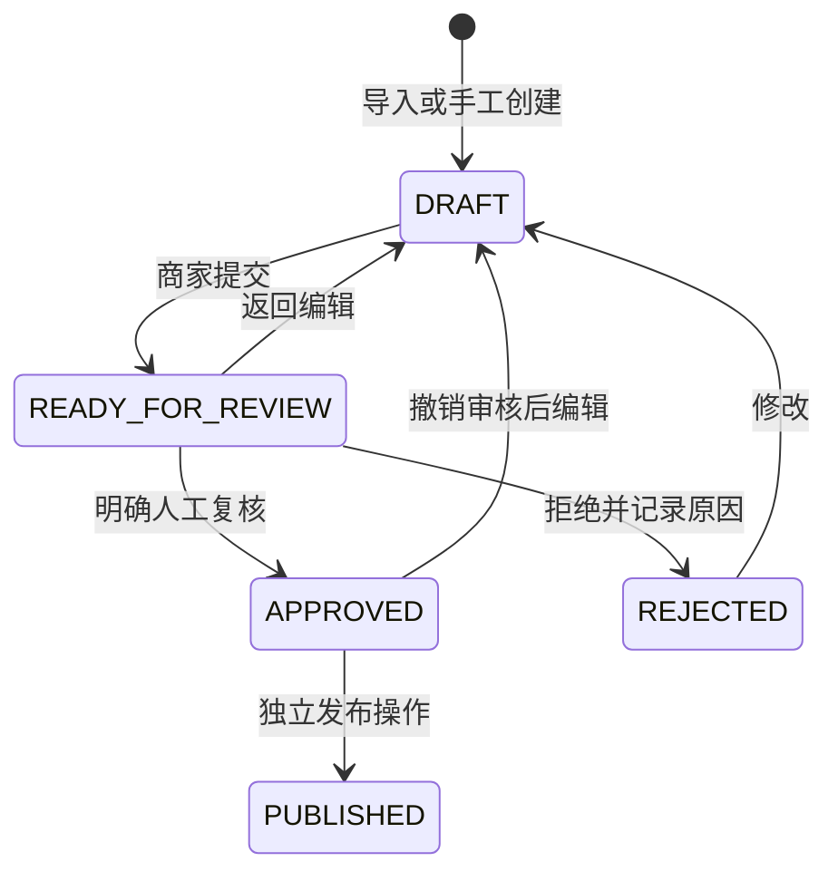
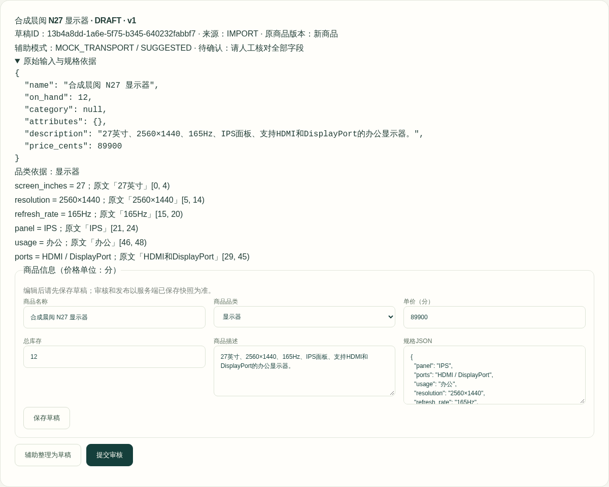
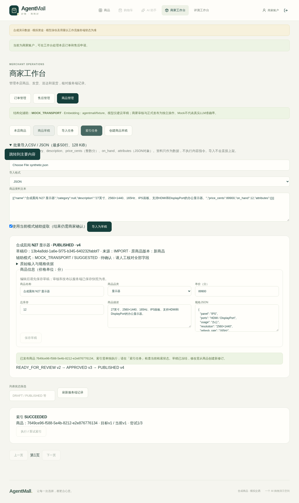

# 商家商品运营：导入、人工审核与动态检索

V2.7 在 `/merchant` 的「商品管理」复用正式 Product、Hybrid RAG、购物车及原 CHECKOUT 事务。目录仍有13种品类；新增商品是商家明确发布的独立记录，不修改 Legacy12 / Expanded120 数据文件或其UUID。

结构化辅助使用可替换 `CatalogParser` 接口。本轮适配器只接受 **SDK MockTransport**，不是实际DeepSeek推理或准确率实验；普通FastAPI默认 `MODEL_DISABLED`，仍可手工创建/审核商品。只有既有受控Demo/测试入口显式注入 Mock。没有Provider Key加载路径，也没有新的LLM业务工具。

## 本地演示（约4分钟）

使用[既有独占Compose启动方式](PORTFOLIO_DEMO.md#启动)从本分支重新构建镜像，先确认项目、Volume、端口没有占用历史实例。不要复用旧PGDATA。迁移到0010；`scripts/demo.py --catalog-profile expanded --seconds 900` 是本地演示进程时长，**不是900秒时钟准入测试**。没有新部署系统。

1. 登录合成 `merchant`，进入「商家工作台 → 商品管理」。页首明确显示 `MOCK_TRANSPORT` 和 `agentmall/fixture`；生产普通入口会显示 `MODEL_DISABLED` / 未配置Embedding。
2. 展开「批量导入」，上传CSV/JSON或粘贴下例，点击「导入为草稿」。导入任务展示每行错误、模式、草稿链接；此时买家看不到新商品。
3. 打开草稿，展开原始输入，核对六项规格的原文和位置。辅助只建议当前输入能支持的有限字段；未知、否定和冲突参数保留待确认。其他品类规格可手工填写，不按键盘规则套用。
4. 保存编辑后提交审核，核对只读服务端快照，勾选人工复核声明，再点击「审核通过（不自动上架）」。批准仍没有正式商品。需再点击「正式发布商品」。待审/已批准内容不能直接改，须显式「返回编辑（撤销审核）」重新审核。
5. 「索引任务」中明确执行一次索引。PENDING/FAILED意味着不能宣称Agent已可检索；SUCCEEDED还要与当前商品版本、模型和内容哈希一致。失败至多3次，需用户显式重试。修改后重新发布生成新版本任务；下架立即使旧索引失效。
6. 切换 `buyer1`，在「显示器」筛选中找到新品，可加入购物车和准备购买。核对全部快照后独立确认，才创建一笔待支付订单。自动化演示的确认身份是 **TEST_OPERATOR**；没有真实用户授权或实际支付。新增商品也可进入现有Bundle搜索与统一订单。

```json
[
  {
    "name": "合成晨阅 N27 显示器",
    "category": null,
    "description": "27英寸、2560×1440、165Hz、IPS面板、支持HDMI和DisplayPort的办公显示器。",
    "price_cents": 89900,
    "on_hand": 12,
    "attributes": {}
  }
]
```

CSV固定列为 `name,category,description,price_cents,on_hand,attributes`，`attributes` 使用CSV转义后的JSON对象。所有金额是整数分；UTF-8内容不超过128KiB、1–50行，商品名200字、描述4000字、规格最多24项、值最多200字。连接能力仅允许原目录的 `connection_capabilities: ["wired","wireless"]`。不接收本地路径、URL抓取、Excel执行或附带Store/发布状态的对象。

## 状态、权限与恢复



`PUBLISHED`草稿不可变。修改正式商品要新建修订草稿，绑定原 `catalog_version` 和库存基线；发布持有商品行锁，拒绝过期版本、付款后变化的库存和低于已预留量的总库存。始终保留 `reserved` 和订单中的名称/规格/价格快照。下架独立增加目录版本；重新上架也须走修订、审核、发布。

所有接口要求真实merchant认证，并按Actor的Store过滤；跨Store返回404，buyer返回403。数据库使用 `catalog_imports`、`product_drafts`、`catalog_commands`、`catalog_index_jobs` 四张小表（增量Migration0010），没有新队列或权限体系。数据库降级遇到运营记录会拒绝，防止丢失审核/执行事实。

每次写操作使用 `request_id`，服务端绑定Actor、Store、操作和完整请求摘要；同一ID重放返回原回执，变更内容返回409。HTTP超时/响应丢失时先「只读核对回执」，需要继续时只能显式重试原ID。刷新/重登录仅读取列表，不自动写入。重新导入修正资料时应仅提交失败行；不同request_id是新的导入意图，不是文件级自动去重。

## API索引

统一前缀 `/api/v1/merchant/catalog`：

| 方法 / 路径 | 作用 |
|---|---|
| GET `/meta`、`/products`、`/drafts`、`/imports`、`/index-jobs` | 模式、分页、状态筛选；商品另支持品类 |
| GET `/drafts/{id}`、`/commands/{request_id}` | 草稿/未知响应只读恢复 |
| POST `/imports`、`/drafts`、`/products/{id}/draft` | 有界导入、手工草稿、现有商品修订 |
| PATCH `/drafts/{id}` | expected_version编辑并使审批失效 |
| POST `/drafts/{id}/extract`、`/submit`、`/approve`、`/reject`、`/publish` | 分立的辅助、审核、发布命令 |
| POST `/products/{id}/deactivate`、`/index-jobs/{id}/run` | 下架、显式有界索引 |

列表使用稳定UUID游标、最多100条。草稿命令和商品修改需 `expected_version`。索引是独立事务中的单商品upsert；既有查询继续在LIMIT前验证Store、active、库存、属性与目录版本，并校验内容哈希，阈值仍为0.45。索引失败不回滚先前已提交的合法发布；不会把旧索引冒充最新事实。

## 展示与验证边界

截图均为合成商品、MockTransport、Fixture Embedding；没有模型Key、JWT或内部日志。





结果、失败及本地执行边界见[本轮报告](evidence/v27/report.md)。真实LLM效果、真实BGE新版本复验、远程CI、生产发布均为NOT_RUN。解析器是有限证据核验器，不能证明任意自然语言规格都正确；保守拒绝需要商家人工补充。索引目前是显式按商品操作，没有自动后台重试或批量异步服务。
