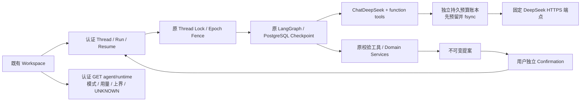

# 本机 Live Playground

T15-A接入真实 `ChatDeepSeek` SDK，最初只执行MockTransport离线验证；之后历史提交617cdf29完成[T15-B1单次真实Smoke](evidence/t15-c/b1-public-summary.json)。本版本源码已变化，**当前源码LIVE_AGENT_VERIFIED=NOT_RUN**；不能复用已结束的B1许可。现有 Fixture 演示和普通 FastAPI 启动不自动变成 Live。打开 `/agent/workspace`，服务端状态区分 Fixture、MODEL_DISABLED、SDK MockTransport 和 Live；前端环境变量不能授予 Live 身份。

## 边界与调用链

普通 `agentmall.main:app` 的 `multi_models`、`durable_single_model` 保持 None。只有 `python -m agentmall.playground --enable-live` 通过新授权、价格/源码、专属环境、本地 BGE 和 Key 检查后，才为 Supervisor、Shopping、Order、AfterSales、Single 注入真实 SDK。



Supervisor 路由来自模型的 `route` function；Specialist 工具来自模型 function calls，经原 Pydantic/所有权/来源验证执行。没有新增硬编码业务路由或自动批准工具。购买与退货各自等待确认；订单进入同一个详情页，模拟付款再独立批准。购物车规则沿用 T14-P1。

全局账本与图内预算同时生效，取更严格者。每次 SDK 发出前在本地 `.playground/ledger.json` 持久预留：次数、保守输入上界 1,048,576 tokens、单次输出最多 2048 tokens、峰值未命中价格及总时限。合法完整 Usage 才释放未用预留；失败、超时、缺失 Usage、非法工具、模型身份异常均保留预留并暂停整份账本。实际账单永远与估算分开，当前为 UNKNOWN。

账本只保存请求摘要和安全元数据，不保存 Key、消息、模型思维或完整对话。浏览器只得到本人/本店/当前 Run 的计数；账本不会因新 Thread、刷新、重启而清零。同 Run/node/role/ordinal 已发送的调用遇到缺失 Checkpoint 时拒绝再次付费发送，宁可停止为 `MODEL_REPLAY_BLOCKED`，不宣称外部 exactly-once。恢复已有业务回执沿用原接口，不自动追加模型请求。单服务器文件租约避免共享账本的重复服务进程。

## 当前可以执行的无 Key 检查

```bash
PYTHONPATH=. backend/.venv/bin/python -m agentmall.playground --describe
```

仅输出模型、建议上限、源码指纹及 NOT_GRANTED，不生成授权、Live 账本或请求。无配置、未显式启用、旧 T12 授权、过期价格、源码变化都会 NO_GO。`--check` 只检查本地策略/授权/数据库标记，不加载 Key；BGE 可加载性、Key 和客户端检查仍属于实际启动门禁。

## 历史T15-A启动方案（保留原实现边界，新运行须遵循当前手册）

详细场景和费用见 [首次 Smoke 待批准方案](evidence/t15-a/live-smoke-proposal.md)。原T15-A时此计划未执行；其后B0/B1在独立环境完成真实验证。本版本或新的工作副本没有可复用的B1授权，实际新环境/新价格/新策略必须重新准入。操作说明见[当前安全运行与恢复手册](REAL_AGENT_DEMO.md)。

1. 检查 Docker 内存余量、55441/8017/5187 端口和项目身份。不得停止已有演示或修改全局 Docker 资源；余量不足就停止。独立项目固定 `agentmall-playground-local`，数据仅 `.playground/postgres-data`。
2. 在本工作副本使用锁定的 embedding extra 和经 `evals/data/embedding_manifest.json` 核验的公开 BGE Revision `7999e1d3359715c523056ef9478215996d62a620`。模型只读挂载 `.models`；缺失不会自动下载或改用 Fixture。构建镜像或分发模型另受第三方许可证要求约束。
3. 明确选择准备环境后，使用独立配置初始化新 test_/cp_ schema。此步骤不调用模型；专属随机环境 UUID 同时写入 schema COMMENT 和 mode600 环境记录，拒绝借用无标记库。已有环境只校验、不会重置。

```bash
docker compose -p agentmall-playground-local -f compose.playground.yaml up -d --wait postgres
docker compose -p agentmall-playground-local -f compose.playground.yaml build server
docker compose -p agentmall-playground-local -f compose.playground.yaml run --rm server python -m agentmall.playground --init-environment
```

4. 根据实际环境 UUID 和最终镜像 `--describe` 指纹准备 mode600 的 `.playground/policy.json`。字段见 `PlaygroundPolicy`：enabled=true、evidence_mode=LIVE_DEEPSEEK、新 session_id、environment_id、source_sha256、UTC price_checked_at、官方 price_source、model_id=deepseek-flash，以及独立授权的所有上限。核对 24 小时内官方价格；若源码/价格/预算变更须重新取得绑定新 policy SHA 的授权。不要编辑历史 Manifest。
5. 只在用户明确批准具体策略、预算、场景以后，记录 mode600 `.playground/approval.json`：purpose=agentmall-live-playground-v1、approved=true、真实 session_id、policy_sha256、可查的新用户授权 approval_reference。仓库不附可执行授权样例，不生成或复用 T12 许可。预算消耗后不得删除账本换 session 续费。
6. Key 由操作人在本地安全方式设置到服务端 `DEEPSEEK_API_KEY`，不放入命令字面量、Git、Vite、URL、截图、日志或本文。Compose 只按变量名转发；程序在所有前置门禁后才读取。关闭 SDK debug 和外部 LangSmith tracing；不使用外部代理/重定向。

```bash
# 仅限另行批准后的实际启动；默认 Compose command 只 --describe。
docker compose -p agentmall-playground-local -f compose.playground.yaml run --rm server python scripts/playground_server.py --enable-live
# 另一终端，本机浏览器 http://127.0.0.1:5187/agent/workspace
cd frontend
AGENTMALL_API_TARGET=http://127.0.0.1:8017 npm run dev -- --port 5187 --strictPort
```

应用 Uvicorn 仅监听容器 localhost，受限桥接由 Compose 仅发布到宿主机 127.0.0.1；还校验 HTTP Host 和客户地址。不得改成公网监听或使用测试控制 API。默认启动总窗口最多 1200 秒；Provider 单次最多 30 秒，SDK retries=0。退出只停止自己创建的进程，不删除账本、私有 Checkpoint 或环境记录；后续窗口须新授权，不能以重启延长预算。

刷新后 JWT 仍需重新登录，Thread 导航引用可保留。GET Thread、Proposal、Order、Case、Events 和 `/agent/runtime?run_id=...` 均走认证与对象归属检查。结果未知先核对持久状态，不盲目新建业务或随机重试。

## 本轮离线验证方式

测试使用独立 `agentmall-t15-a-tests` 项目，PG 宿主端口 55440、API8016、Mac Vite5186；内部仍满足 T09 对 127.0.0.1:55433/agentmall_test 的保护。`compose.playground-tests.yaml` 合并 `compose.ci.yaml`，后端容器640MiB，浏览器/Vite在宿主机。测试入口 `scripts/playground_test_server.py` 单独挂载受控测试路由；生产 Live 工厂只用普通 `create_app`，不导入此入口。

全量 pytest 中旧四进程预算测试超过640MiB并出现已保留的 OOM/137；最终仅完整后端阶段使用本地三行覆盖（`services: {runner: {mem_limit: 1152m}}`），浏览器后端仍640MiB，分阶段运行，不修改全局资源。复现完整后端时可将该内容保存到忽略目录的 `.t15-a/backend-memory.yaml`，额外传入 `-f .t15-a/backend-memory.yaml`；未降低原断言、增加skip或重试。所有最终结果以报告实际回执为准，不能将分阶段验收称为单容器一体化CI通过。

MockTransport 测试使用真实 SDK、真实 FastAPI、PG17、领域服务及官方 Checkpointer；模型响应是合成 HTTP fixture，不能据此证明模型能力。该入口的默认完整回归继续使用原 Fixture，只有显式 `/__test/sdk-mode` 切到标明 MOCK_TRANSPORT 的真实 SDK。外网连接和真实 Key 读取被测试边界阻断。

原冻结评测与两轮 Live 证据不变；它们绑定旧源码，不能作为 T15-A 新源码的付费授权或 Live 成绩。最终命令、数量、失败和资源证据见 [T15-A 报告](evidence/t15-a/report.md)。

T15-C新增GET响应头X-Server-Time（客户端展示为server_time）及提案倒计时，未改变不可变购买快照或领域确认事务。[当前手册](REAL_AGENT_DEMO.md)优先解释新版本的停止、授权和恢复；本节历史命令不能替代新价格/源码/环境检查。
