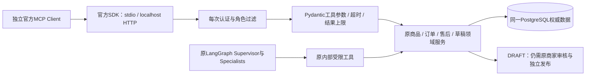
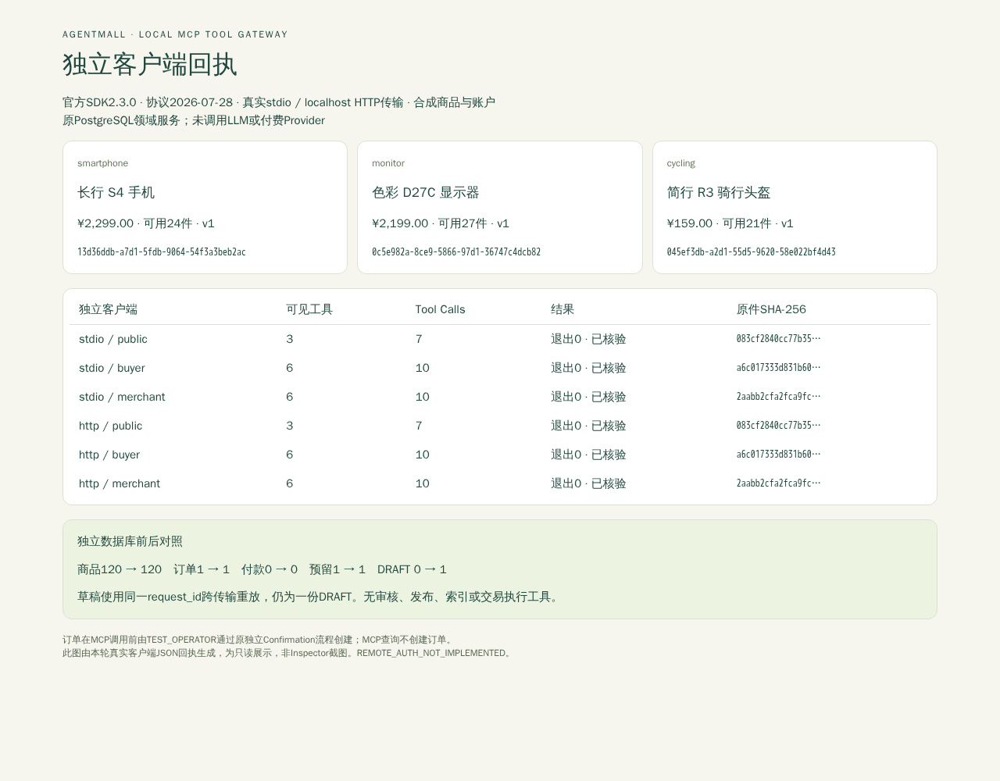

# MCP Tool Gateway：标准协议，原领域规则

V2.8 将现有电商查询和商家草稿入口暴露为标准MCP Tools。使用官方 **MCP Python SDK2.3.0 / mcp-types2.3.0**，不是另写JSON-RPC或固定回答。外部程序经真实stdio或localhost Streamable HTTP调用原领域服务，读取与FastAPI相同的PostgreSQL数据。

[官方Python SDK](https://py.sdk.modelcontextprotocol.io/) · [2026-07-28规范](https://modelcontextprotocol.io/specification/2026-07-28) · [SDK协议兼容说明](https://py.sdk.modelcontextprotocol.io/protocol-versions/)

## 协议与信任边界

- 现代客户端使用 **2026-07-28**：`server/discover`后，每个请求携带协议版本/能力元数据；没有`initialize`握手或`Mcp-Session-Id`。stdio可保持进程连接，连接存在不等于持有业务授权或协议会话。
- HTTP只接受该现代版本。未知/旧HTTP版本返回426，头/正文冲突仍由SDK校验拒绝。stdio另实测SDK Client的旧`initialize`兼容路径 **2025-11-25**；不宣称其他版本已测试。
- stdout仅供协议使用。stdio在SDK解码前限制整帧为64KiB；首字节后未完成帧最多5秒，超长/无换行/非UTF-8输入终止连接，诊断不回显内容。空闲交互不超时。
- HTTP只监听字面地址`127.0.0.1`，检查真实peer、Host、同源Origin，拒绝转发头和URL查询凭证，不配CORS、不信任代理头。请求上限64KiB，使用SDK原生请求级流式响应以传播客户端取消。
- **REMOTE_AUTH_NOT_IMPLEMENTED**：本轮是本地自定义Bearer认证，复用原JWT的签名、issuer、audience、有效期及数据库User校验；不是MCP远程OAuth实现。不得公网代理或部署。公开远程使用前须另行实现正式OAuth、受保护资源元数据和MCP资源Token Audience。



内部Function Calling是模型与应用工具之间的约定；MCP是跨进程的能力接口协议。新增Gateway不替换Shopping/Order/AfterSales、不改变LangGraph状态机。协议、工具注解、模型文字和客户端`--profile`均不授予业务权限。领域服务仍负责身份、Store、事务、版本、幂等和人工确认。

## 九个工具

| 工具 | 权限 | 权威领域能力 / 对应REST |
|---|---|---|
| `search_products` | Public/Buyer/Merchant | `catalog.service.search_products` / GET `/api/v1/products`；当前已发布、类别/关键词/预算、游标 |
| `get_product` | Public/Buyer/Merchant | `catalog.service.get_product` / GET `/products/{id}`；当前价格、可用量、规格与版本 |
| `list_my_orders` | Buyer | `orders.service.list_orders` / GET `/orders`；仅本人、状态与游标 |
| `get_my_order` | Buyer | `orders.service.get_order` / GET `/orders/{id}`；仅本人详情 |
| `check_return_eligibility` | Buyer | `aftersales.service.check_eligibility` / GET `/orders/{id}/after-sales-eligibility`；不创建Case |
| `get_public_return_policy` | Public；带订单仅Buyer | 小型公开政策领域查询；带订单复用原`policy_scope`归属门禁，固定Store/public/有效期/版本过滤，返回数据库原文及来源；无资格或执行授权含义 |
| `list_merchant_catalog` | Merchant | V2.7 `list_rows/product_view` / GET `/merchant/catalog/products`；仅本店含上下架/索引状态 |
| `list_merchant_after_sales` | Merchant | `aftersales.service.list_merchant_cases` / GET `/merchant/after-sales`；仅本店Case |
| `create_product_draft` | Merchant | V2.7 `create_draft/command` / POST `/merchant/catalog/drafts`；只创建DRAFT，原request_id幂等 |

输入Schema禁止额外字段，不能传`user_id/role/store_id/token`。发现列表也按服务器认证角色过滤，列表缓存提示为private/立即过期；猜到隐藏工具名称仍被拒绝。每次调用重新验证JWT和数据库User，禁用账号、Store变更不能沿用旧Actor。订单/售后输出投影保留原DTO的业务类型与字段，去掉用户、店铺、提案和审核人等不必要内部关联；保留字段逐项对照REST原件。

商品搜索复用目录查询，不伪装为新的语义RAG工具；新旧商品事实均来自当前数据库。公开政策接口读取已导入的有效政策原文，不从模型编造条款；库中没有原件就返回`POLICY_NOT_FOUND`，需使用原政策索引初始化流程。原买家知识检索API和0.45阈值没有修改。

## 安全限额和错误

每次工具调用最多5秒（包含排队），最多4个执行中的工具；列表1–20条、查询500字。参数JSON最多32KiB，结构化结果JSON最多64KiB，兼容文本镜像使整个响应仍有界；过大结果明确失败，要求缩小页数，不静默丢项。

结果为`{ok,data,error}`，错误同时设置MCP `isError`；代码与说明是白名单，不包含异常堆栈、JWT、DSN、原始Prompt或Checkpoint。非法参数/权限失败不写业务。只读工具启用数据库READ ONLY事务。

超时或连接丢失后的写入结果可能是 **UNKNOWN**：不自动重发，不新建request_id。使用同一商家身份及原结构化请求/原request_id显式重试，V2.7回执会恢复同一个DRAFT。HTTP断开会取消尚在执行的请求，已提交事务仍由原幂等回执恢复。不存在批准CHECKOUT、付款、退款、发布、库存写入或任意SQL工具。

## 本地连接：独立官方客户端

需要Python3.12和新分支依赖：

```sh
uv sync --project backend --locked --no-extra embedding
```

先按[现有Demo指南](PORTFOLIO_DEMO.md#启动)准备**新的独占**数据库/Schema、迁移和Expanded目录；政策查询还需要既有政策索引。不要指向旧演示数据库。Gateway不初始化、迁移或Seed数据库，也不会自动挂载到普通FastAPI。

从私有运行配置安全提供`AGENTMALL_DATABASE_URL`、`AGENTMALL_JWT_SECRET`、`AGENTMALL_DB_SCHEMA`及可选Store/issuer/audience。这些属于本地业务服务配置，文件应放Git忽略目录并设0600；不在命令历史、源码或共享MCP配置中写真实值。Gateway禁用自动读取仓库`.env`；不读取Provider Key。

### stdio（建议先展示）

```sh
uv run --project backend python scripts/mcp_demo.py --stdio --profile public
```

该独立程序通过官方Client启动`python -m agentmall.mcp_gateway`子进程，发现工具，搜索手机/显示器/骑行装备、读取当前商品详情，并验证商家工具对Public拒绝。不会发起模型调用，也不需要单独HTTP服务。

Buyer/Merchant凭证是通过已有`POST /api/v1/auth/login`取得的短期业务JWT，仅配置在客户端受保护的`AGENTMALL_MCP_TOKEN`环境变量。不要把JWT放进URL、Tool参数或浏览器存储，不要公开登录回执。可交互无回显输入后执行：

```sh
read -r -s AGENTMALL_MCP_TOKEN
export AGENTMALL_MCP_TOKEN
uv run --project backend python scripts/mcp_demo.py --stdio --profile buyer
unset AGENTMALL_MCP_TOKEN
```

不同角色使用独立客户端凭证；`--profile`仅选择演示断言，不能切换服务器身份。Buyer展示本人订单/资格；Merchant展示本店商品和售后。凭证不足则失败，不伪造空成功。

### localhost Streamable HTTP

确认8038空闲后，另一个终端启动：

```sh
uv run --project backend python -m agentmall.mcp_gateway --transport http --host 127.0.0.1 --port 8038
```

客户端使用同样的受保护凭证，服务器不使用进程全局MCP_TOKEN替其他HTTP客户端授权：

```sh
uv run --project backend python scripts/mcp_demo.py \
  --url http://127.0.0.1:8038/mcp --profile buyer
```

HTTP不提供OAuth资源发现地址；跨Origin Inspector页面不会自动被放行。**本轮实际验收使用官方Python Client，不声称Inspector UI已验收**。其他stdio Host可配置命令`uv run --project <repo>/backend python -m agentmall.mcp_gateway`及私有环境，SDK自动处理其真实协议版本；只承诺本文实测的两个版本。

### 显式创建一份草稿（Merchant专属，可选）

```sh
uv run --project backend python scripts/mcp_demo.py --stdio --profile merchant \
  --draft-request-id '<为本次操作新建并保存的UUID>'
```

该选项是明确写入开关；输入是脚本中的合成显示器资料。客户端会使用原UUID调用两次，必须返回同一DRAFT。没有该选项只查询。随后在原商家工作台核对草稿，审核和正式发布仍是独立操作；MCP不会代做。HTTP和stdio之间也可以用同一UUID恢复，不能换UUID绕开原操作身份。

## 3—5分钟展示路线

1. 说明内部工具与MCP边界，展示本页九个工具及角色矩阵。
2. Public stdio程序执行发现、三品类搜索和价格详情；展示真实返回Product ID，而非固定模型文字。
3. Buyer客户端展示本人待支付订单及退货资格；另一买家的同一Order ID不可读。
4. Merchant客户端展示本店商品和售后；可选开关创建DRAFT并重放，工作台中仍需人工审核。
5. 展示本轮脱敏客户端/数据库前后回执：产品、订单、库存和付款未因查询变化，仅一个草稿增量；关闭客户端后普通API继续可用。

[真实独立客户端回执](evidence/v28/clients.json) · [定向测试及保留失败](evidence/v28/report.md)。这些是合成业务、无真实模型；不是Live智能效果、远程OAuth或生产SLA验证。Gateway没有新增前端页面，现有商家工作台/Bundle/SSE/评测页的浏览器回归另记录。


