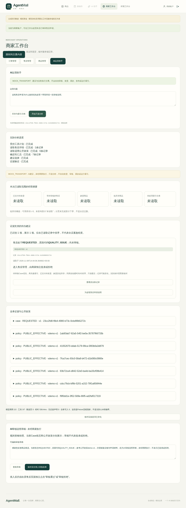
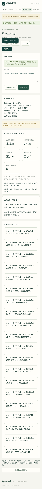

# V2.11 · Merchant AI Operations Copilot

商家通过自然语言选择只读业务工具，读取本店实际订单、售后、库存及索引任务，再查看可追溯的待办和审核说明草稿。入口：商家登录 → `/merchant` → **AI运营助手**。这是工具驱动的Agent工作流，不赋予模型发货、审核、退款、发布、修改库存或运行索引的能力。

**本版模型为SDK MockTransport**，只模拟计划与建议选择；实际工具连接独占PostgreSQL并复用原领域服务。没有真实Provider/Key或LLM效果验收。普通`create_app()`的商家模型为`MODEL_DISABLED`，不会因打开工作台加载Key。[完整结果及A—N矩阵](evidence/v211/report.md) · [命令、源码和日志SHA](evidence/v211/verification.json) · [实测合成场景](evidence/v211/scenarios.json)

## 工作流与边界


Copilot是独立、请求内的小型StateGraph，没有给买家Supervisor或buyer-only Thread新增商家权限，也没有新表、持久Worker或消息队列。刷新、退出或断线取消分析；跨浏览器分析历史**不持久化**。原业务记录仍持久化。重新分析只能由商家明确点击，不自动重试；分析重放也没有业务写工具。

模型用Pydantic Schema选择工具名/参数、已验证证据ID与草稿语气；不接受自由生成的事实数字、业务状态或审核决定。服务端从真实记录组装说明，越权工具、伪造ID、错误动作/状态或额外声明均拒绝。模板化建议的语言能力有限，不等于真实LLM推理能力。

## 八个受控只读工具

| 工具 | 权威数据来源 | 输出范围 |
|---|---|---|
| list_merchant_orders | orders.list_merchant_orders | 本店订单、状态和商品金额快照；无买家身份/地址 |
| get_merchant_order | owned_order(merchant=True) + order_view | 本店指定订单的原快照 |
| list_merchant_after_sales | 原MCP read_domain → list_merchant_cases | 本店Case有界列表，再按原get_case读取安全字段 |
| get_merchant_after_sales | 原get_case(merchant=True) | 原因代码、状态、版本、审核/收货时间；不回显买家留言或审核私文 |
| list_merchant_products | 原MCP read_domain → catalog_operations | 上下架、价格、可用库存、目录版本、当前索引状态；不把商品描述作为指令 |
| list_catalog_index_jobs | 原list_rows / job_view | 原任务状态、有效状态、版本及尝试数，不执行任务 |
| get_applicable_policy | 原owned_case/order、eligibility_for、public_policy | 关联订单政策版本、可访问的有效公开政策、独立资格信息 |
| summarize_operations | 确定性程序 | 已读取范围的PAID/REQUESTED、库存、索引及状态分组 |

身份只取原JWT认证后的Actor；输入Schema禁止`user_id`、`role`、`store_id`和任意SQL。未登录401、买家403、跨店对象404。即使模型省略对象读取，服务端也先验证用户选中的Case归属；聚焦Case的计划必须绑定同一Case和政策，不能悄悄换记录。

分析使用`REPEATABLE READ READ ONLY`和每语句2秒超时。最多6个模型选择的读取工具，另加1次确定性汇总；最多2轮模型调用、整个图15秒。分页每页最多20条、每工具最多5页、合计最多200条列表记录。SDK Mock请求包含系统消息和工具Schema的完整序列化正文最多32,768字节/次，累计65,536字节，作为保守输入Token上界；SDK请求输出上限2,048 Token/次，Fixture报告Usage另行校验。结果最多20条建议、60,000字节。失败保留错误，不能把未完成当作0或成功。

## 如何解读统计与证据

- `PAID`才进入待发货建议，`PENDING_PAYMENT`不会被说成已付款。
- 可用库存=`on_hand-reserved`；0为缺货，1—5为低库存，仅针对ACTIVE商品。
- REQUESTED为待审核；没有替商家做approve/reject判断。
- 索引FAILED、PENDING、RUNNING及过期STALE均提示人工检查，不能把上架或任务成功直接等同于当前可检索。
- 统计只涵盖本次已读取且已声明的筛选范围。未读项显示“未读取”；存在下一页或从中间游标开始时显示“至少”及覆盖范围，不声称全店总数。
- 建议按“待审核Case、失败索引、已支付待发货、缺货、低库存/其他待处理”分组，同类按创建时间/ID排序。仅比较已读取的记录，不虚构紧急SLA。
- 每条建议绑定ID、状态、版本、读取时间和指纹；卡片提供原工作台入口。模型无证据声明不能渲染为成功建议。
- **Case申请时的eligibility_snapshot是历史资格**。政策证据中的`current_new_request_eligibility`检查当前能否再次申请，已有Case会出现`ACTIVE_CASE_EXISTS`；不表示已有Case被拒绝。当前Case状态、公开政策原文、非约束性建议与商家最终决定各自独立。

结果是同一读取快照，而非始终最新。使用草稿前再次通过只读`/check`核对指纹；若记录变化，阻止填入。核对与新分析串行化，旧响应不会把新分析导航回旧表单。实际审核表单还保留原`expected_version`保护，确认后的任何业务仍由原服务决定。

## HTTP与前端

- `GET /api/v1/merchant/copilot/meta`：身份、Mock/Disabled及边界。
- `POST /api/v1/merchant/copilot/analyze`：JSON只读分析，便于自动化核验。
- `POST /api/v1/merchant/copilot/analyze/stream`：相同图，fetch-SSE逐节点进度和最终脱敏结果。
- `POST /api/v1/merchant/copilot/check`：重读所属对象并比较指纹，不修改记录。

问句放JSON正文；JWT只在内存Authorization头，不进入URL或localStorage。原买家GET SSE保持兼容。事件只包含已完成计划、工具名、记录数、耗时和验证状态，没有模型内部思维。断流关闭事务，页面显示失败且不自动重发。切换用户/Store或退出登录会取消连接并清空数据。

审核草稿可编辑和复制。点击 **核对后仅填入审核表单** 最多打开原Case并填入“审核说明”；商家仍要独立点击原“审核通过”或“审核拒绝”。填入与审核之间再发生版本变化时，原乐观锁拒绝。原模拟退款仍需要原提案、Confirmation和单独执行，不属于Copilot。

## MCP复用

默认直接Adapter复用现有MCP `read_domain`的商家商品/售后映射，业务规则没有复制。可选`MerchantMCPReader`接受可信组合根建立的官方SDK Client，只允许`list_merchant_catalog`、`list_merchant_after_sales`；实际MCP结果必须与同一认证Actor的原领域结果一致才采用。JWT只在可信客户端认证配置，绝不传给模型。

测试使用现有SDK Client通过真实localhost Streamable HTTP进行编码、传输、解码与Tool Call，验证非空商品和Case结果一致；伪造响应或不同身份数据被拒绝。主Copilot未强制走MCP，不启动额外Gateway；没有更改原9工具、认证或角色发现规则。远程OAuth仍是 **REMOTE_AUTH_NOT_IMPLEMENTED**。不要将localhost配置公开部署。

## 3—5分钟本地演示

仅使用新建的Fixture Demo项目和合成账户，按[现有启动指南](PORTFOLIO_DEMO.md#启动)或独占测试环境运行。**不要复用当前仍运行的历史Demo数据库/端口。** 已有`backend/tests/web_e2e_server.py`是显式Mock组合根；普通uvicorn API仍为Disabled。

1. 合成买家通过原独立确认创建两笔订单并模拟付款；商家将其中一笔发货/送达，买家通过原售后申请及独立确认创建REQUESTED Case。测试自动操作者统一标为 **TEST_OPERATOR**，没有真实支付。
2. 商家登录 → 工作台 → AI运营助手，输入`帮我看看目前有哪些订单需要发货，以及还有哪些退货申请等待审核。`。看到实际工具先完成，再出现摘要；核对PAID订单ID与REQUESTED Case ID。
3. 点击Case建议的“为这笔售后草拟说明”，明确选择记录后输入`这笔售后申请为什么值得优先处理？帮我草拟一段审核说明。`。展开原资格、当前状态及公开政策版本。
4. 编辑草稿 → 核对后仅填入审核表单。展示原Case仍为REQUESTED，尚未选择批准/拒绝、没有退款。需要演示审核时由操作者在原表单独立点击，不由Copilot代做。
5. 返回助手选择库存与索引示例，查看真实可用库存与任务状态；Expanded120场景默认两页读取40条，明确显示部分范围。另一窗口变更记录后再核对，旧建议失效。

可复现的浏览器自动化，不需要另外编写curl交易步骤：

```sh
# 安装锁定的离线核心依赖，使用新PG17/pgvector、独占Schema及匹配的55433端点。
# .env.rag仅放本轮合成测试DSN，不输出、不提交，不配置Provider Key。
uv sync --project backend --locked --no-extra embedding
npm --prefix frontend ci
npm --prefix frontend run install:browser
backend/.venv/bin/python -m pytest --ci-offline-core -q backend/tests/test_merchant_copilot.py
npm --prefix frontend run test:e2e -- merchant-copilot.spec.ts
```

端口和运行/停止约定复用[商家工作台指南](MERCHANT_WORKBENCH.md#复现浏览器冒烟)。本次自动化运行于独占Linux aarch64容器、PG17/pgvector；未使用真实BGE/LLM，不借用V2.10语义质量成绩。

本地长时查看可复用`compose.ci.yaml + compose.portfolio-local.yaml + scripts/demo.py`，但须用新的项目名、空闲端口及本轮私有override覆盖runner镜像名和输出目录，避免改写共享tag或历史输出。例如新项目`agentmall-v211-demo`、独占镜像`agentmall-v211-demo-runner:local`、空闲端口8038/5208。启动前用`compose config --quiet`核对实际配置；无权停止未知实例。`--prepare-return`只准备已送达的合成订单，仍需买家单独申请退货，不能说它自动创建了Case。本文不自动启动或保留新的演示服务。

## 截图与限制





本次Fixture测试验证工具选择、权限和事实引用合同，不验证真实模型理解或生成准确率。建议采用受控模板/语气，开放自然语言能力未验收。分析无持久历史；优先级是明确规则，不是预测模型。大范围扫描、生产负载、任意崩溃恢复及真实Live均NOT_RUN。既有历史失败、旧Oracle、冻结评测与MCP权限保持原样。没有Push、远程CI、部署或下一阶段Worker开发。
