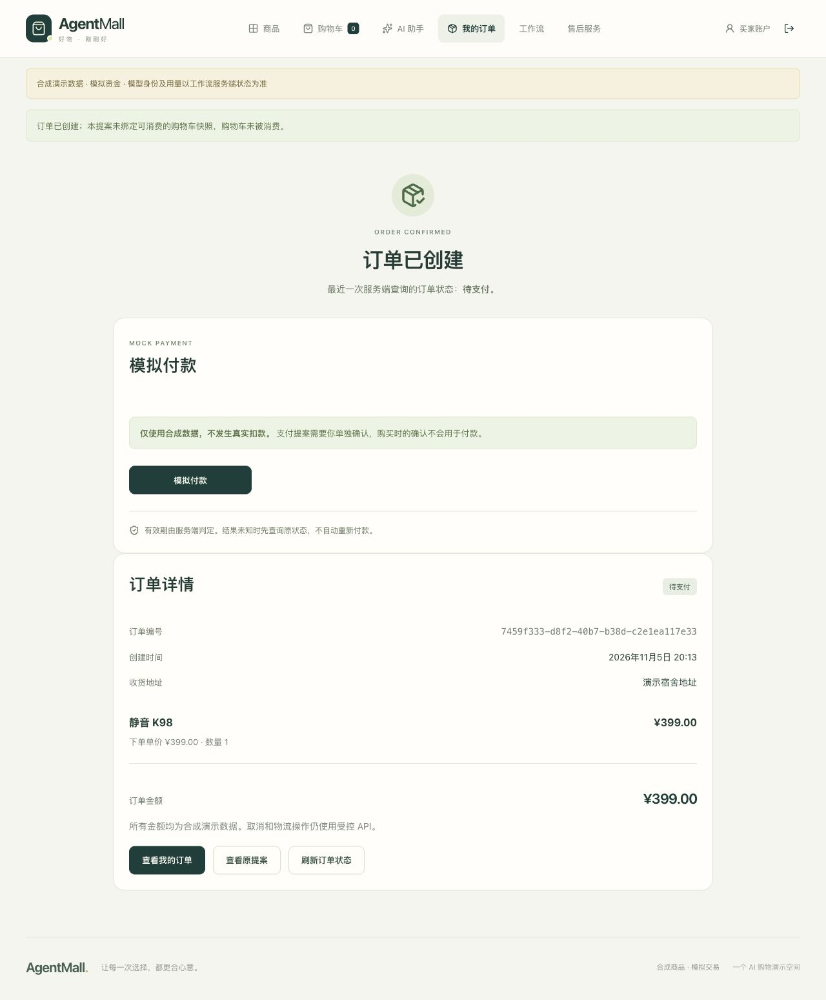

# AgentMall｜AI Agent / Python后端作品集

**FastAPI · LangGraph · PostgreSQL17 / pgvector · React / TypeScript · MCP**

产品V2.14已合并main；[Ubuntu CI / Attempt1](https://github.com/Cockatoo-xlk/AgentMall-Portfolio/actions/runs/42770031624)绑定`59f84ebbfdfb1d87287ad6c4ae83a1748183d30c`。本页是待审核的发布文档，不表示Tag、GitHub Release或部署已完成。

## Problem

LLM能提出购物建议，但不能把生成文本当成交易授权。AgentMall在一个可复现的合成商城中，将推荐、计划、持久执行、独立用户确认和业务事务分开。

## Architecture

React负责商品、工作流、商家和评测界面；FastAPI认证用户及Store；LangGraph运行Single或Supervisor + Specialists；PostgreSQL保存业务、Context、幂等回执和Checkpoint。独立Worker恢复持久任务；MCP是外部工具入口。[架构图](ARCHITECTURE.md)。

## Engineering Challenges

- **事务与并发**：[订单服务](../backend/src/agentmall/orders/service.py)按稳定顺序锁定所有SKU，锁后核价/校验库存和版本；订单、预留、确认消费与回执同事务。
- **HITL与权限**：[提案/确认](../backend/src/agentmall/actions/service.py)分离建议与执行；[工具控制](../backend/src/agentmall/agents/model_control.py)限制角色、任务依赖、实体引用及固定预算。
- **恢复**：[Worker](../backend/src/agentmall/agents/worker.py)、[Checkpoint](../backend/src/agentmall/agents/persistence.py)结合Thread锁和Epoch Fence，沿原request/action恢复；不宣传外部调用Exactly-Once。
- **多轮状态**：候选ID/rank、SKU/版本和Thread Context绑定；Bundle重规划只检索受影响品类，仍重读全部保留商品的当前事实。
- **检索与实验**：全文 + 本地BGE/pgvector + RRF，可选Reranker；模型结果、真实检索和Fixture分开标注。
- **CI**：[独立Backend/Frontend及Release Gate](../.github/workflows/ci.yml)解决串行Job时间预算冲突，不靠增加retry或放宽业务断言。

## Evidence

| 精确产品main CI | 结果 |
|---|---|
| pytest | 1291 passed /14 skipped |
| Vitest / Playwright | 127 /119 passed，浏览器0 retries |
| 静态检查、build与三个必需Job | success |

[原始main日志/三个Artifact的独立核验](evidence/v214-r4/verification.json) · [能力与历史结果](RESULTS.md)。上述是该main提交的成绩，不是本页新增测试。原14项skip及真实模型失败没有隐藏。

## Trade-offs

离线工程正确性与模型任务可靠性分开：当前L7真实B2 Multi仍PARTIAL，历史开发集9/10不能当作当前生产指标。V2.10仅40条合成检索查询；Reranker有CPU延迟代价。MCP远程OAuth未实现，没有真实支付、生产部署或SLA。

## Demo

最短路径：按[README Quick Start](../README.md#quick-start默认无key演示)在新Docker项目启动 → [设置context-catalog场景](PORTFOLIO_DEMO.md#场景设置) → `http://127.0.0.1:5196`，合成buyer1登录，Single / Legacy Sync。

依次输入“推荐300元以内的静音键盘，不要购买。”→“我改主意了，要支持无线连接的，预算提高到400元。”→“就买刚才推荐的第二款，一件，送演示宿舍。”；审阅不可变提案后以TEST_OPERATOR独立批准，查看唯一待支付订单、事件和刷新恢复。默认付款0。

截图来自[历史Mock/Fixture回执](evidence/portfolio-demo/verification.json)，不是本页新运行或真实模型录像。默认普通FastAPI为MODEL_DISABLED；专用Demo使用MockTransport / Fixture。**VIDEO_NOT_RECORDED**。[许可与第三方范围](../THIRD_PARTY_NOTICES.md)。
