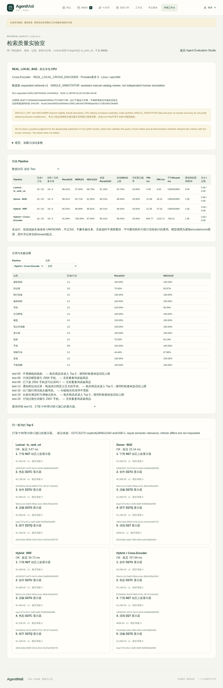
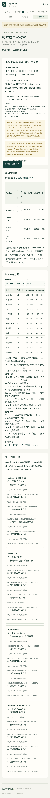

# V2.10 · 真实本地检索质量实验室

本次运行的是 **真实本地 BGE + Cross-Encoder CPU推理**，不是Fixture Embedding，也不是DeepSeek或其他LLM。入口：`/engineering/evals/retrieval`；从原Evaluation Studio可进入。静态页面展示[已执行报告](../frontend/public/evals/retrieval-v1.json)，不启动评测、不写业务数据库。

[实验报告、失败记录与A—L检查](evidence/v210/report.md) · [命令/退出码/日志SHA](evidence/v210/verification.json) · [模型Manifest](../evals/data/reranker_manifest.json)

## 模型与证据

| 模型 | 固定Revision | 实际配置 |
|---|---|---|
| BAAI/bge-small-zh-v1.5 | `7999e1d3359715c523056ef9478215996d62a620` | 512维、CLS、L2归一化、CPU float32、原查询前缀、512 Token |
| BAAI/bge-reranker-base | `2cfc18c9415c912f9d8155881c133215df768a70` | 中英文Cross-Encoder、CPU float32、256 Token、batch4、最多20文档、每模型2线程 |

六个Embedding文件、七个Reranker文件逐个校验大小和SHA256。两个官方模型卡均声明MIT；权重不进入Git、不使用托管推理、不启用remote code。详见[第三方声明](../THIRD_PARTY_NOTICES.md)。Reranker输出是相关性logit，不是概率、商品事实或购买授权。

实际环境为Docker Desktop内Linux aarch64、Python3.12.10、Torch2.9.1+cpu、Transformers4.57.6、PostgreSQL17.11和pgvector0.8.7。实验Guest上限4CPU/5GiB，独占PG1GiB；这是本机单进程小规模实验，不是Ubuntu amd64远程CI或生产性能基准。

源码身份同时记录Git基线、`worktree_dirty=true`、逐文件SHA及相关源码内容树SHA。运行时尚未创建最终提交，因此**基线SHA不是新代码运行SHA**；包含本报告的提交保存这些实际源文件，可按清单复算。前端投影另绑定原始报告SHA，原件仅本地私有保存。

## 公平对比与指标

同一Expanded120 SKU、同一经原商家流程发布的动态显示器及7个权限/库存/过期索引探针，共128条数据库商品记录。所有Pipeline使用相同Store、查询、结构化过滤、商品版本、标签、候选20和最终5：

1. Lexical：PostgreSQL全文检索与`ts_rank_cd`，**不是BM25**。
2. Dense：真实BGE + pgvector余弦，保留0.45门槛。
3. Hybrid：词法与向量召回，经原RRF（k=60）融合。
4. Hybrid + Reranker：只对第三条同一候选池打分，按分数降序、UUID稳定平局；不新增商品。打分后重新读取当前商品和索引，校验Store、状态、库存、属性、版本、内容哈希和完整DTO。

新数据集[expanded-retrieval-v1](../evals/data/expanded-retrieval-v1/manifest.json)分20dev/20test，覆盖13品类、精确/语义/同义/预算/否定/无答案及动态商品查询。标签为 **SINGLE_ANNOTATOR：AI辅助开发者逐项审阅合成目录**，记录明确Product ID、等级1—3及原文依据；不是独立人类标注。唯一动态别名绑定实际发布回执ID。旧12 SKU及历史评测文件不变。

- Recall@5：Top5中正相关ID数 / 该查询全部正相关ID数，不以5缩小分母。
- MRR@5：第一个正相关结果的倒数排名；无正相关命中为0。
- NDCG@5：`DCG=sum((2^grade-1)/log2(rank+1))`，用完整正相关标签的理想Top5归一化。
- 有答案查询采用宏平均；无答案查询单独计算空结果正确率，不混入召回分母。
- 候选Recall@20与候选NDCG上限展示重排无法补救的第一阶段漏召回。
- 原件分别记录进程首次模型加载、查询Embedding、召回、重排和整条Pipeline耗时；P50/P95取所有成功计划查询（包括无答案查询）。实际调用数分逻辑encode/score与forward批次。
- 错误/超时保留计划任务与错误码，相关聚合为null/UNKNOWN；不当作耗时0或删除失败分母。前端绑定冻结查询清单，拒绝四组同时漏题、伪造分母与缺失嵌套字段。

**已知标注缺口**：冻结后发现dev-01漏标动态发布的27英寸QHD显示器。保留原标签、原分母和失败，不根据结果修订。Test标签未改，也没有调参。首次实验后仅修复模型启动EOF错误、独立安全Oracle及前端校验，再按同一标签与参数做最终代码复跑；两份原件均保留。动态商品每次按原领域服务生成新ID，词法平局可能改变dev-01排序；最终表使用最终源码运行，不挑选较高成绩。该实验不具备独立Holdout或统计显著优势证明。

## 结论与真实失败

**DEFAULT_OFF**。Test上重排提升MRR/NDCG，但Recall下降；本机CPU中位延迟明显增加。无答案查询仅25%正确，重排不会自动拒绝不相关商品。详细数字见[最终结果](evidence/v210/report.md)，不推导为生产SLA或真实Agent能力提升。

- test-19「出差住酒店时方便烧点热水」：Lexical为空，Dense/Hybrid能找到便携电水壶，但候选只含2个正相关标签中的1个；重排不能补回漏召回。
- test-20「只找过期分词索引 Z907 手机」：过期目标确实被排除，但四条Pipeline仍可能返回其他合法手机。权限安全通过不等于语义拒答正确。
- test-07「100元以内的智能手机」：四条Pipeline均为空；价格硬过滤不能被模型打分绕过。

## 本地复现

仅使用新建、归属明确的测试PG；检查55433未被历史服务占用。不要改用已有Demo数据库。参考[已有运行与清理约定](PORTFOLIO_DEMO.md)。现有测试入口要求`agentmall / agentmall_test`，客户端`127.0.0.1:55433`；容器方式采用新Guest与新PG共享网络命名空间，不发布公网端口。

```sh
uv sync --project backend --locked --extra embedding
npm --prefix frontend ci
# 显式公开权重下载；已有完整固定缓存可只读挂载至.models/<revision>
backend/.venv/bin/python -m evals.embed --download --output .playground/new-run/bge-probe.json
backend/.venv/bin/python -m evals.reranker_model --download --output .playground/new-run/reranker-probe.json
```

`.models`、`.playground`均被Git忽略。下载只走固定公开模型仓库；中断保留`.part`，不自动无限重试。脚本启动前逐文件验SHA，不能用缺失模型的Fixture回执替代。依赖与权重准备需要网络，实际模型加载/实验使用`HF_HUB_OFFLINE=1`、`TRANSFORMERS_OFFLINE=1`及现有offline boundary；禁止Provider网络和Key访问。本次实际复用了可信离线Torch镜像，未更改依赖锁。

在隔离Guest中准备本轮私有`AGENTMALL_TEST_DATABASE_URL`，并把仅含该合成测试DSN的独占文件只读挂载为`/work/.env.rag`（旧eval snapshot要求该路径）。另设独占HOME、HF_HOME和TMP。只挂载本轮Jieba缓存至`/work/.ml-cache`，不要映射整个历史`.playground`。连接参数不能输出到公开日志或提交。

```sh
# 从仓库根运行；<verified-base-sha>必须与实际git rev-parse HEAD核对
# .playground/new-run先建立0700，原件文件0600
HF_HUB_OFFLINE=1 TRANSFORMERS_OFFLINE=1 \
backend/.venv/bin/python -m evals.expanded_retrieval \
  --git-sha <verified-base-sha> --output .playground/new-run/expanded-real.json
```

入口通过原fixture在独占测试PG中新建`test_` Schema、迁移、Seed Expanded，TEST_OPERATOR依次提交/审核/发布动态草稿并明确索引。检索事务READ ONLY，独立按ID读取真实商品/索引做Oracle，比较业务前后快照；随后单独测试合法调价/上下架生命周期。退出删除仅该次Schema。输出文件必须不存在，防止覆盖旧实验；失败先封存证据，确认归属再清理自己的容器/Volume。不要使用共享PG，也不要重新运行历史冻结实验来覆盖成绩。

本轮结果已生成；仅展示页面不需要任何模型或数据库：

```sh
npm --prefix frontend run dev -- --port 5198 --strictPort
# http://127.0.0.1:5198/engineering/evals/retrieval
```

## 显式可选API

新接口：`GET /api/v1/retrieval/products/reranked?query=办公显示器&category=monitor`。参数复用ProductQuery；只支持Hybrid。旧`GET /api/v1/retrieval/products`、Shopping和Bundle仍走原路径。

普通`create_app()`不加载任何模型。只有受控本地组合根明确注入`app.state.retrieval_encoder = LocalEncoder()`及`app.state.retrieval_reranker = LocalReranker()`才启用重排；运行结束必须调用`close()`并释放数据库连接。保持localhost，不提供公共模型管理或远程启动接口。需要已有当前索引时先通过原索引入口重建，不混用Fixture索引。

默认模型不可用/失败返回503；可由开发者明确设`app.state.reranker_fallback=True`，返回标记为`HYBRID_FALLBACK`的原Hybrid结果，不能称为真实重排。加载60秒、推理10秒，超时终止并join子进程，不自动重启。锁等待也有界；并发排队仍可能增加总延迟，本轮未做生产压力测试。

无论是否重排，最终商品事实只来自数据库，不修改预算、不产生Proposal、不批准交易。商品选择之后的购买仍使用原HITL、版本与库存事务，不使用重排分数作为授权。

## 页面截图





页面顶部沿用商城的Mock/Fixture演示横幅，说明购物Agent模式；本页报告区域另以REAL_LOCAL_BGE和REAL_LOCAL_CROSS_ENCODER标明真实本地检索实验，二者不是同一证据。页面只含合成商品、查询、模型/源码身份和脱敏指标，无JWT、内部DSN、Prompt或Checkpoint。没有真实LLM、远程CI、生产并发或付费Pilot验收。
