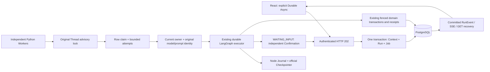

# V2.12 — Reliable Asynchronous Agent Worker

## Execution audit and design

The existing HTTP executor already commits the Run and accepted Thread Context before invoking LangGraph. A dedicated PostgreSQL connection holds the Thread advisory lock. Each activation claims a new epoch and worker token; RunFence checks that token, epoch and the actual advisory lock before journal, checkpoint and guarded business writes. NodeStore commits outputs before the official PostgreSQL Checkpointer commits graph progress. Recovery replays journal outputs and reads original domain receipts. Confirmation, proposal expiry, inventory and order idempotency remain domain responsibilities.

V2.12 adds a dispatch index, not another business state machine:



Migration `0011` adds `agent_jobs`: Run/Thread composite foreign key, canonical intent key, type, state, available time, claim token, attempts, error and finish time. `(run_id, intent_key)` is unique. Start and resume scheduling share the original acceptance transaction. Resume payloads stay in `resume_journal`; a queue row contains only their identity. An interrupt has one canonical resume job, including when another browser sends the same decision under a different request ID. Conflicting decisions fail closed.

## API and UI

- Legacy Sync: existing `POST /api/v1/agent/threads/{id}/runs`, `/resume`, and Run `/recover` remain compatible.
- Durable Async: explicit `/runs/async`, `/resume/async`, and `/runs/{run_id}/recover/async` return **202**, including Run ID and safe Job metadata. This acknowledges persistence, not execution success.
- `GET /agent/threads/{id}` includes the latest Job for each of the bounded 50 Runs, with the original buyer/Store authorization.
- Original event GET and SSE contracts remain intact. New committed `job_queued`, `job_executing`, `job_state`, `job_blocked` events expose only codes, counts and identifiers.
- Select “Durable Async” before starting a Run. The default is Legacy Sync. The page distinguishes QUEUED, EXECUTING, WAITING_INPUT and blocked/failed dispatch from the authoritative Run result. No Worker means QUEUED; no model result is fabricated.
- Reconciliation reads by the original request ID. Polling and SSE never repeat a start, confirmation or resume POST. JWT remains in memory; logout requires login again, then restore the Thread link. Pending HITL retains the original independent confirmation card.

## Worker and recovery semantics

```sh
# Same trusted composition root/settings/model identity as the API:
uv run --project backend python -m agentmall.agents.worker \
  --factory your_local_composition:create_app --concurrency 2
```

A factory is an operator-selected Python module, never an HTTP argument. Ordinary `agentmall.main:create_app` remains MODEL_DISABLED and does not load a Provider key. A runnable deployment must explicitly inject its models and encoder into both processes. Tests/demo below use only synthetic MockTransport.

The Worker scans at most 20 ready records, acquires the **original Thread lock before claiming**, locks the Job row with SKIP LOCKED, validates the current DB user/Store and frozen model/prompt identity, then invokes the original executor. Different Threads can run concurrently; one Thread cannot. Queue finalization checks the original advisory lock and claim token even after the executor clears its Run token.

The five-second availability timestamp is a discovery delay, **not a lease that revokes business authority**. An old live process holding its original lock cannot be replaced merely because that timestamp expires. If its database lock connection is lost, the original epoch/token and pg_locks fence rejects subsequent writes. A replacement obtains the actual lock and a new epoch.

Default limits: concurrency 1 (configurable 1–4); polling 0.5 seconds (0.1–5); at most three claims (configurable 1–5). Recoverable executor errors requeue with 2 × attempt seconds delay. Five consecutive infrastructure failures stop the Worker with a nonzero exit after bounded backoff (`--once` exits nonzero on its first infrastructure error). Jobs remain durable. A blocked job requires explicit inspection/recovery; no browser automatically repairs it. Recovery revalidates the restored original environment and requeues the already accepted Resume, preserving its Confirmation. For an unaccepted expired proposal, “恢复调度 / 结束过期等待” queues only server-verified expiry reconciliation; a new quote still requires a separate explicit Run. Recovery keys include the prior Job identity, including failures before epoch activation. SIGTERM stops accepting new work and drains the current bounded execution; SIGKILL relies on database recovery.

This provides **at-least-once attempts**, not general exactly-once execution. A model request interrupted after dispatch may repeat. Persistent reservations and original budgets are retained; original per-activation wall-clock behavior is unchanged. Business safety comes from original proposal identities, independent Confirmations, transactional inventory and Idempotency-Key receipts. No new payment/refund execution tool is exposed.

## Offline local demo (MockTransport only)

Use the existing Compose demo approach from `PORTFOLIO_DEMO.md`, a **new project name, new Volume and free loopback ports**. Do not use or stop an already running historical demo. Add `--async-worker` to the existing runner command:

```sh
python scripts/demo.py --catalog-profile expanded --async-worker --seconds 300
```

This is the existing container-only Fixture launcher, not a host database installer. It starts the existing local test API and Vite plus an **independent Worker OS process**. Its trusted offline factory uses the real ChatDeepSeek SDK with `httpx.MockTransport`, Fixture embeddings, a new business/Checkpoint schema and synthetic credentials. It never reads a Provider key. The SDK-enabled workflow label is not evidence of Live inference: the demo is **MOCK_TRANSPORT / FIXTURE_EMBEDDING / TEST_OPERATOR** throughout. Do not deploy test control endpoints publicly.

1. Login as synthetic buyer1, create a Multi Thread, select Durable Async.
2. Submit “推荐300元以内的静音键盘，不要购买。” Observe the queue and committed timeline; no order.
3. Submit “就买刚才推荐的第二款，一件，送演示宿舍。” Observe WAITING_INPUT and immutable snapshot.
4. As **TEST_OPERATOR**, explicitly approve that snapshot. Resume queues separately. The Worker creates one PENDING_PAYMENT order; payment count stays zero.
5. Close/reopen, log in again and restore the Thread URL. Read history; never resubmit purchase to restore a view.

For a deliberate queued demonstration, leave the independent Worker stopped until after HTTP 202, then start the identical composition root. `backend/tests/test_worker_process.py` and `frontend/tests/worker.spec.ts` contain reproducible independent-process and browser examples. The private test factory is in `backend/tests/worker_process_helpers.py`; it is not a Live authorization facility.

## Evidence and boundaries

See `evidence/v212/report.md` for actual command results and source binding. Deterministic fault injection exists only in the test composition root; production Worker has no kill hooks. Tests use real isolated PostgreSQL, official Checkpointer, actual SIGKILL, and a stopped/resumed stale OS process. A separate current-database outage test rejects new connections, observes bounded Worker failure, then restores only the newly owned database.

Supported scope: trusted local deployment, multiple Worker processes, Single/Multi and Bundle execution. Merchant Copilot remains request-scoped. No distributed queue, cross-region scheduler, production SLA, automatic approval, paid model validation or remote CI claim. Historical Live/CI evidence remains historical. The V2.12 recovery checks do not turn the older Journal evidence limitations into retroactive proof.
