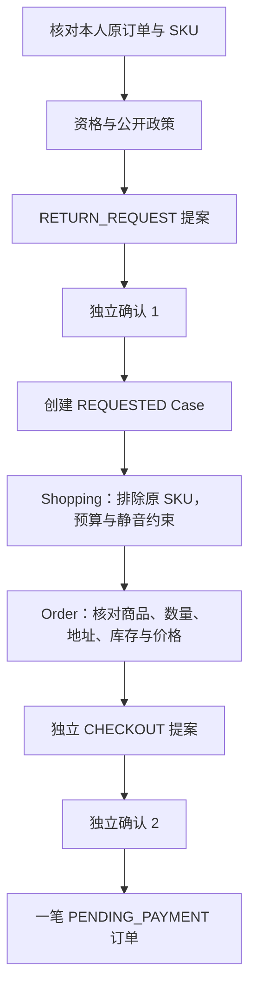

# V2.13：退货与替代购买的离线可靠性修复

本轮基于 `b5d6a685dac44a8bf28aaf357af0e4f4b69f7d5f`，仅运行离线测试。历史真实 Pilot 的完整模型、路由和工具轨迹没有保留，**无法确认原 B2 失败的唯一根因**。下面的复现是 `RECONSTRUCTED_FIXTURE`，不能作为历史 DeepSeek 轨迹，也不能证明真实模型复测已通过。

测试数量、源码指纹与日志哈希见[本轮回执](evidence/v213/report.md)。

## 现有证据能够说明什么

原 Pilot 的 manifest、持久费用账本和 summary 可以核对：5 个任务、Single/Multi 各一次，56 次 Provider 请求均已获得有效 Usage；9/10 Episode 通过。B2 Multi 为 PARTIAL，12 次模型调用、6 次工具调用，34,620 输入 / 3,555 输出 Token。历史高峰价格估算总费用 ¥0.393226，并非账单平台的实际扣费证明。

账本只有调用身份、时刻、模型、Usage 和费用元数据。它没有 Supervisor 决策、工具参数/结果或独立业务数据库快照。12 次调用达到上限，不能单独证明触发了 `BUDGET_EXCEEDED`，也不能推出具体哪一个 Agent 消耗了哪些调用。

旧 Oracle 的 `unauthorized_action_count=2` 将 CONFIRMATION 标签也计入其中；这里同时出现两次 `DECLARED_DECISION_MISSING`。`unsupported_claim_count=1` 也包含 `REQUIRED_SOURCE_MISSING`。这些聚合诊断不能直接证明发生了两次越权数据库写入或一次虚构事实。原件不包含足以重建实际 Case/订单增量的字段。现有 `evals/diagnostics.py` 已有更细的诊断分类，本轮没有修改 Oracle 或历史摘要。

## 确认并修复的通用缺口

`specialists/runner.py` 原来可能把“有成功读取回执”的 Specialist 判为 `done`，即使它接到的是 `prepare_return` / `prepare_checkout`，却没有准备相应提案。

确定性复现中，AfterSales 调用 `get_order`、`check_eligibility`、`retrieve_policies`，随后提前结束。原实现把该子任务交回 Supervisor；后续替代任务受到既有退货确认依赖门禁阻挡，最终 PARTIAL。这个缺口可独立复现，但没有证据证明原真实 B2 恰好走过相同路径。

最小修复：

- 将可写目标完成与相应的成功工具回执绑定；读到业务事实不再自动完成该写目标。
- 对可修正的提前结束使用原有**全 Run 共享的一次**编排修复机会，保留本 Specialist 已验证的 `prior_tool_results`，减少重复读取的需要。
- 修复反馈使用实际受控工具名；Bundle 购买指向 `prepare_bundle_checkout`，普通购买指向 `prepare_checkout`。
- 确定性资格拒绝、unsupported、既有工具错误保持失败/拒绝语义，不强制尝试写入。
- Single 原有安全校验、Supervisor 动态选择、授权、HITL、事务和幂等实现均保留。

修复不会自动选择商品、准备提案、批准或执行业务。模型仍须选择合法工具；下一次调用照常扣减预算。模型 12 / 工具 16 / Delegation 4 / Steps 24 / 90 秒 / 输出 12,000 Token 上限均未修改。

## 依赖与约束边界

现有 `Supervisor.awaits_return_decision` 防止在退货决定前继续替代购买；`RunContext.validate_tasks` 拒绝重复 Task ID / 语义签名、未就绪依赖、约束漂移和越权引用。原订单/SKU 从服务端事实建立，原 SKU 加入排除列表；数量 1、500 元、静音和演示地址不能由 Handoff 改写。购物与售后通过不同引用范围隔离。无需把 LangGraph 改成固定业务脚本。

新增真实 PostgreSQL 测试中的完整路径使用 **11 次模型 / 6 次工具**，两次不同 Confirmation，最终一份 REQUESTED Case 和一笔新增待支付订单。原订单的模拟付款属于测试前置准备；检查的是**付款增量 0**，不是谎称整个数据库从来没有付款。

## 可选脱敏诊断

现有持久 RunEvent 新增安全投影：路由任务/依赖、受控约束和来源、Context 版本、Specialist 开始/结果、模型与工具计数、预算、HITL/Resume 和错误码。没有新增事件存储或审计框架。

`evals.run.run_episode(..., diagnostics_dir=Path(...))` 可选择导出独立 JSON；CLI 增加 `--agent-diagnostics-dir`。此开关不会绕过既有 Manifest、Live 授权或密钥访问前置校验。建议在已获准的隔离 Fixture 环境使用；本轮测试直接验证了 B2 Fixture 的导出路径。

- 仅投影枚举、整数、资源 UUID、已验证的限制和状态；不导出回答、原始消息、Prompt、Provider Header 或原始 Checkpoint。
- Bundle 检索 query 与非枚举 layout 被剔除并标注 omitted；再次投影持久事件仍保持相同脱敏结果。
- 缺失计数/Usage/Confirmation 数据显示 UNKNOWN，不补成 0。
- 初始订单准备的 Confirmation 与 Agent Episode 的 Confirmation 分开标注。
- 错误分类仅表示已观察错误码所属家族，不能充当根因证明。
- 目录 0700、文件 0600，拒绝叶路径符号链接与覆盖旧文件，单文件最多 1 MiB、事件最多 2000 条并显式标记截断。
- 导出失败记录 `DIAGNOSTIC_EXPORT_FAILED`，不改写 Oracle 结果；未来真实复测必须另行核对诊断文件确实完整。

## 待单独授权的真实 B2 复测

**当前状态：NOT_RUN / OWNER_APPROVAL_REQUIRED。** 不沿用原 ¥5 授权。本轮没有读取 Key、创建 Live Ledger 或批准回执。

| 项目 | 拟议单次实验 |
| --- | --- |
| 源码 | 本修复的最终本地 Commit；授权前填写完整 SHA 和代码指纹 |
| 任务 | 冻结 B2 原输入与 Oracle，仅 Multi 一次，失败也计入分母 |
| 资源 | 新独占 PostgreSQL、业务/Checkpoint Schema、Runtime；身份目前 UNBOUND |
| 模型 | 现有实现 `deepseek-flash`；执行前核对官方身份/工具协议与返回 fingerprint，别把可变别名当固定权重版本 |
| Agent 上限 | 12 次模型、16 次工具、4 Delegation、24 Steps、90 秒、单次输出最多 2048、累计输出最多 12,000 |
| 外层请求 / Token | 最多 12 个请求；保守输入总上限 12,582,912；输出总上限 12,000 |
| 外层费用 / 时间 | 建议 ¥2.50；总执行窗口 300 秒，均须独立批准；不放宽每个 Run 的 90 秒 |
| 价格 | 执行前 24 小时内官方快照；本轮未验证当前价格 |
| 确认 | RETURN_REQUEST 与 CHECKOUT 各一次独立决定；用户或预先获准的 TEST_OPERATOR，不自动替代用户 |
| 停机 | 首个网络 UNKNOWN、Usage 不完整、业务/权限/预算/Oracle/证据失败即停，不自动重发 |

按**历史**输入 ¥2 / 输出 ¥8 每百万 Token 计算，单次满额保守费用预留是 `(1,048,576×2 + 2,048×8)/1,000,000 = ¥2.113536`。¥2.50 允许串行预留并在有效 Usage 结算后释放差额，但**不保证一定能完成 12 次调用**；余量不足时原账本必须拒绝下一请求。未知响应保留完整预留并停止。新价格或更高预留可能使本方案不可行，届时先重算、再授权。

当前 CLI 的 `--architectures` 只接受配对 `single,multi`，Live 也只接受 repeats=1，不能伪装成已经有 `--architectures multi`。单 B2 Multi 复测应使用现有 `run_episode(task, "multi", 0, ...)`，由下一轮审核一个小型私有执行包装器：先校验新 Manifest / 源码 / 预算 / 价格，再沿既有 Live 边界加载 Key。当前包装器、Environment、Session、Policy 均未建立或批准。

若需要三次重复实验，属于另一份授权：三个全新 Schema、同一全局持久账本，最多 36 请求、累计输出 36,000，拟议总费用 ¥5；首个失败停止、不挑绿、不宣称统计显著改善。三次实验不包含在上述一次方案中，也不包含在本轮授权中。

成功标准必须同时核验：两份不同且各自只消费一次的 Confirmation、唯一 REQUESTED Case、唯一新增 PENDING_PAYMENT 订单、正确替代 SKU / 数量 / 金额 / 库存预留、付款增量 0、来源与排除条件、Checkpoint/RunEvent 一致性、完整诊断、无未解释错误。保存原失败三文件哈希与新原件，不能补造旧轨迹。
