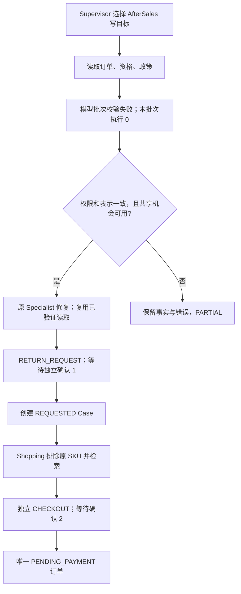

# V2.13-L2：工具批次校验与有界修复

基线：`342c3c199984efb89bc649dcb3b1892aeb82da41`。分支：`codex/v213-l2-tool-batch-repair`。本轮全部为离线验证，真实 Provider 请求和 Key 读取均为 0。[最终测试回执](evidence/v213-l2/verification.json)随本地修复提交绑定，不代替真实模型复测。

## L1 已知事实与证据缺口

L1 私有 findings、summary、ledger 和诊断文件记录：B2 Multi 为 PARTIAL；9 个真实请求均 SETTLED，输入 24,999 / 输出 2,348 Token，按历史高峰价格估算 ¥0.068782。两轮 AfterSales 各成功读取订单、资格、政策，随后 INVALID_TOOL_BATCH，最终 REPEATED_DELEGATION。Episode 确认为 0，精细 Oracle 记录未经授权业务写入为 0。旧 `unauthorized_action_count=2` 仍包含“缺失预期确认”，不能改读为实际越权写入。

完整诊断有 48 个事件且未截断；另一个空诊断文件仍原样保留，不算成完整 Episode 证据。所有九份原件哈希在本轮结束前复核，没有修改历史结果，也没有重新连接原 Pilot 数据库。

**原始 Tool Arguments 未保存，具体 JSON / Schema / 权限子类型仍为 UNKNOWN。** L1 的目标是 `assess_return`；旧投影没有 read_only 字段，不能凭任务名断言具体被拒绝工具或参数。本轮补充的合成错误均明确是新测试，不是重建出来的真实模型输出。

源码确认的浪费机制：

1. 多种模型批次错误原来统一成为 INVALID_TOOL_BATCH，无法进一步区分。
2. 该错误没有进入原 Specialist 的一次共享修复机会，成功读取记录虽被保留，模型却没有得到局部纠错反馈。
3. 原语义签名包括 facts、交接引用与 evidence_refs。第一次读取改变这些字段，新 subtask_id 可以绕过旧签名；因此第一次相同目标重派发可能被接受。L1 最后一次拒绝究竟来自同 ID 还是签名冲突，原投影不足以区分。

## 校验与错误合同

公共错误码保留既有 INVALID_TOOL_BATCH、UNORDERED_WRITE_BATCH、REPEATED_TOOL_CALL；新增细分仅作为受控诊断。没有放宽任何工具 Schema 或角色白名单。

| 细分诊断 | 处理 |
| --- | --- |
| MODEL_INVALID_TOOL_CALL | 表示结构不完整或原始/SDK 表示冲突；拒绝，不猜测修复 |
| TOOL_ARGUMENT_JSON_INVALID | 只有全部名字、身份、权限和表示一致性检查通过，才可请求一次格式修复 |
| TOOL_ARGUMENT_DUPLICATE_KEY | 含义有歧义，拒绝，不自动选择某个值 |
| TOOL_BATCH_TOO_LARGE | 整批合法权限内、尚未执行的结构错误，可使用共享修复机会 |
| TOOL_BATCH_UNORDERED_WRITE | 已验证权限内的混合读写批次整体拒绝，可要求重新生成独占写批次 |
| TOOL_ID_INVALID_OR_REUSED | 非法或已接受过的 ID，拒绝，不重放 |
| TOOL_NOT_ALLOWLISTED | 权限拒绝，不进入本地修复 |
| READ_ONLY_TOOL_VIOLATION | 只读交接试图写入，拒绝，不升级权限 |
| TOOL_WRITE_SCOPE_VIOLATION | 写工具与已授权目标不符，拒绝 |
| TOOL_AUTHORITY_ARGUMENT_FORBIDDEN | 模型试图提供 Actor、Store、批准、价格或库存等非工具参数，拒绝 |
| TOOL_ARGUMENT_SCHEMA_INVALID | 合法工具的参数类型/必填字段错误，可在原权限内修复；额外权限字段不属于此类 |
| TOOL_REPEATED_CALL | 已执行写调用、修复轮内已成功的相同调用，或超过旧重复上限，拒绝 |

判定依据不只是错误名：先检查**所有**原始与 SDK 调用的角色、读写权限、目标、ID，以及两种表示的一致性；再验证所有参数。后面的权限错误不能被前面的格式错误掩盖。只有全批通过后才预留工具预算和进入执行。非法批次的读与写均不执行。

当前锁定 SDK 会丢弃成功解析后参数的原始 JSON 拼写，因此重复 Key 不能只靠事后字典检查。`deepseek_model()` 的非流式结果适配在 SDK 归一化前提取固定错误枚举，然后立即丢弃原字符串；没有保存原始参数或异常字符串。正常无工具回复的 null 被视为无调用。此适配依赖当前锁定的 SDK 接口，升级依赖须重新验证。

## 一次共享修复与事实复用

仍为模型 ≤12、工具 ≤16、Delegation ≤4、Steps ≤24、输出 ≤12,000 Token、Run ≤90 秒。单次输出仍最多 2048。没有新建每 Specialist 重试额度，也不改变费用账本。

格式修复、已有 INCOMPLETE_WRITE_GOAL 和原有非法读写批次修复共享同一 Run 的一次机会。下一次模型调用正常扣预算。修复耗尽、权限拒绝、ID 重用和重复写入均不能因为更换 Agent 或 Task ID 再拿到机会。Single 的工具并集也不能让未请求购买/退货的畸形参数获得格式修复；有效参数仍由原领域服务按原合同拒绝。

重试保留原 Specialist 的 records、observed 引用、runtime facts、引用来源、tool_ids 和 tool_repeats。反馈只传原目标、固定错误分类、已知字段名及本 Specialist 已验证的工具结果；不让模型更改用户预算、原订单、排除 SKU、数量、静音或地址。修复轮重复调用已经成功的相同工具会被拒绝。原领域服务仍重新检查当前 Actor、订单、资格、价格、库存和版本；旧读取不替代最新业务校验或用户批准。

## 重派发、Checkpoint 与诊断

失败或 blocked 子任务在现有持久 signatures 中增加失败目标标记，身份使用 target、goal 和**可信 Runtime 用户约束**，不包含 subtask_id、动态 facts、引用顺序或读取后扩展的排除 SKU。它只在当前 Run 生效；新的明确用户请求仍走既有授权和业务幂等检查。独立的其他目标可继续，已经提交的 Case 不会回滚。

没有新增状态表或迁移，没有重写 StateGraph。标记使用原 Snapshot/Checkpoint/Node Journal 持久路径。细分拒绝事件复用原 RunEvent、预算标记与 Epoch Fence 原子提交，并在 Node Journal 回放中去重；写诊断前释放验证读取事务的共享 fence，避免嵌套锁等待。原 advisory lock、订单事务、库存、Confirmation 和恢复规则未放宽。

新增安全投影包括：角色/子任务、已知工具名、固定细分类别、受控字段名、模型校验或执行阶段、本批次是否执行、共享修复是否消耗、失败后预算、重新派发是否实际执行。Handoff 增加 read_only。未知字段名、任意模型字符串、参数、Prompt、JWT、Key、密码与原始 Checkpoint 不进入新增诊断。错误类别可区分 MODEL_OUTPUT_INVALID、TOOL_SCHEMA_REJECTED、POLICY_DENIED、REPAIR_EXHAUSTED、DELEGATION_REJECTED、BUSINESS_OPERATION_FAILED。

## 合成 B2 验证路径

SDK MockTransport 分别注入合法退货工具的 JSON 错误和缺少必填参数：

两种成功路径均为 11 次模型、6 次工具，两份不同 Confirmation；确认由独立合成测试操作者（TEST_OPERATOR）调用原 API，不代表真人批准或 Agent 自行确认。修复反馈保留 50,000 分预算、静音、原订单/SKU、quantity=1 和演示宿舍。实际 PostgreSQL 核对唯一新增 Case 和订单、正确替代 SKU/金额、reserved=1、付款增量 0。两次 Resume 重放没有新请求或重复业务记录。

重复 Key、越权工具不获得本地修复。另一个场景先修复 AfterSales，再让 Order 缺少必填字段：第二次修复被拒绝，已确认的 Case 保留，新增订单为 0，终态 PARTIAL。原订单准备含模拟付款，检查的是本 Episode 的付款增量，不是伪称整个数据库从未有付款。

## 真实复测仍需独立授权

本轮没有读取真实 Key、发请求、创建新 Live Ledger 或批准回执。L1 授权不能用于新源码。

下一次只针对 B2 Multi 一次：绑定本修复最终 SHA/代码指纹，新独占业务与 Checkpoint Schema，固定模型配置与当次返回身份，最多 12 请求，建议仍以 ¥2.50 为总费用提案，不增加 Run 预算。执行前重新核对 24 小时内官方价格和单次最坏预留可行性；UNKNOWN 响应保留费用预留并停止，不自动补发。

必须完整保存本轮新增脱敏细分类别、路由/目标/权限、预算和两份独立确认，以及 SQL/Oracle 业务终态。重复实验属于另一份预先固定次数与总账本的独立授权，不以换 Run ID 重置预算。Environment、Session 和 Policy 目前均 UNBOUND，真实复测 NOT_RUN。离线通过不等于 DeepSeek 已通过。
