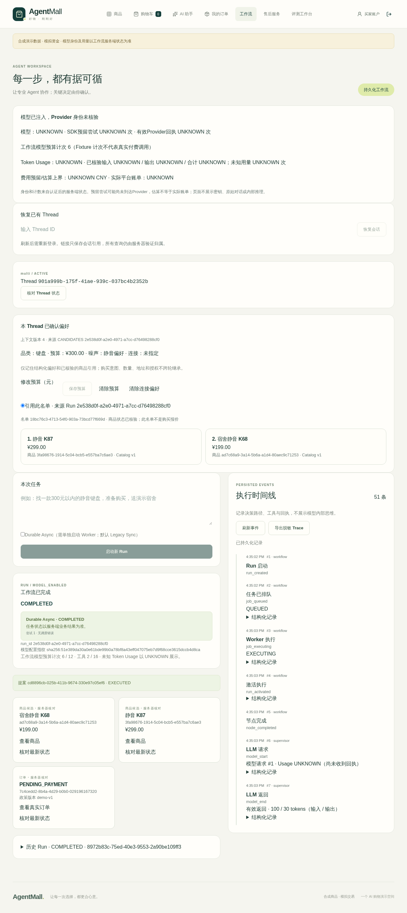

# V2.12 local verification

Base: `1f49cda3f6ae829371d5c900a8f61cb83c202c11` (parent `9424b7d6d0b0ccebb52f219282a93e03038c6120`). Branch: `codex/v2-reliable-agent-worker`.

Evidence category: local Linux aarch64, real isolated PostgreSQL 17/pgvector and official Checkpointer, ChatDeepSeek SDK via MockTransport and Fixture encoder. No real Provider requests, Key reads, remote writes, payments or refunds. Final regression and source hashes are recorded below after execution, not inferred from historical tests.

Directed tests have exercised API 202, atomic rollback, duplicate starts, same interrupt deduplication, real process SIGKILL at model, Node Journal, business commit and WAITING boundaries, stale resumed process fencing, bounded database outage, owner/version denial, expiry, Single and Bundle replanning/checkout. Browser scenario: queue, close page, independent Worker, re-login/restore, independent TEST_OPERATOR confirmation, single order and zero payments.

Historical development failures remain retained privately: initial queue endpoint missing (RED); test fixture name/login, purchase phrase and payment table mismatch; original browser navigation discarded the in-memory JWT; harness dynamically injected the old model instead of the Worker composition; immutable proposal trigger rejected a test's attempted timestamp update. Tests now advance only their injected proposal clock and preserve the real immutable snapshot trigger. A transient private helper syntax error and lint failures were retained. None was converted into a skip or a weaker domain assertion.

Current result: **AGENTMALL_V212_DURABLE_WORKER_READY**. Local-only verification; no remote CI or paid model claim.

First cumulative run: **1101 passed / 14 skipped / 1 failed**. Failure: `test_migration_empty_schema_and_repeat_upgrade` expected the old exact table set without `agent_jobs`. The updated assertion adds the required new table and retains exact equality. This run preceded final review fixes and is not final acceptance. Independent review also exposed async expired-wait recovery and BLOCKED Resume recovery; both retained RED reproduction tests. A parallel extra diagnostic overlapped the deliberately database-wide outage test and was rejected with PostgreSQL `not currently accepting connections`; the final cumulative/backend and browser validations are sequential.

## Final cumulative verification

| Check | Actual result |
| --- | --- |
| Complete offline pytest | 1106 passed / 14 skipped / 0 failed |
| Complete Vitest | 127 passed |
| Complete Playwright | 119 passed / 0 retries |
| Ruff / format / TypeScript / ESLint / production build | All exit 0 |

Executable source SHA256: `500794586f1074ef0819411eebbdb6f4fef193ec70feba4977a79e5ce3e266ca` (435 files). The final local commit contains this exact verified executable tree. [Machine-readable summary and log hashes](verification.json).

The final run includes 23 added queue/process tests. Forty-five independent OS process receipts were hashed: 33 normal exits, 10 actual SIGKILL exits, and two expected infrastructure-failure exits. One SIGKILL targets a real API process **after its HTTP 202**; the durable Run then completes in another Worker.

| Boundary | Actual check |
| --- | --- |
| A: committed queue / before claim | Kill Worker before claim; same Run recovered. Kill real API after 202; independent Worker completes. |
| B: model in flight | Actual process kill, preserved budget and Run identity; unknown model request may repeat. |
| C: journal before checkpoint | Kill after supervisor or confirmed-execution Journal commit; saved outputs and domain records recovered. |
| D: order committed before final Run | Kill immediately after original order transaction; one completed idempotency receipt, one PENDING_PAYMENT order and one consumed Confirmation. |
| E: WAITING vicinity | Kill with checkpoint interrupt and before Run finalization, or after WAITING commit; no automatic approval/order. |
| F: stale process | SIGSTOP old process, terminate its actual advisory-lock connection, finish with a new epoch, SIGCONT old process; STALE_EXECUTOR and no overwrite. |
| G: identity mismatch | Dispatch BLOCKED before execution; explicit recovery works only after restoring original identity. Prompt checks remain unchanged. |
| H: database unavailable | Owned test database rejects new connections; one-shot fails nonzero, daemon stops after five errors; same queued Run recovers after restoration. |

SQL assertions use independent physical connections: Order/OrderItem, Confirmation.result_ref/consumption, completed execute_checkout receipt, stock reservations and zero payments. Official Checkpointer is read independently. RunEvent sequence is continuous. Bundle recommendation, revision and purchase execute through independent Workers; one order contains four items and total stays within budget. Current owner/Store denial and version guards remain in force.

The browser test closes the original page while queued, runs an independent Worker, re-logs in, restores the Thread, approves a separate proposal as **TEST_OPERATOR**, then refreshes without a second order. Screenshot below is **MockTransport / Fixture Embedding**, not Live DeepSeek. The generic SDK panel deliberately displays Provider identity/usage as unverified; it does not constitute a Live receipt.

## Review, safety and cleanup

Both important review findings have RED reproductions and passing final regression: ending an unaccepted expired wait without approval; and explicitly recovering an accepted blocked Resume after restoring the original environment. A related pre-activation recovery-key collision is covered. The one-shot Worker exit-code test also exposed and fixed an infrastructure-error exit 0.

One minor is deferred: attempts-exhausted BLOCKED is exposed by authoritative GET but does not add its own timeline event. This does not grant execution or alter business receipts.

Forty-one protected source/dataset/lock files were hash-checked unchanged, including order/payment/aftersales/action domain services and the original durable graph, saver, resume and budget implementation. No frozen dataset or historical evidence was rewritten. Only a privacy-reviewed synthetic screenshot and sanitized verification summary accompany this report; raw child logs, failure logs and local credentials stay outside Git.

Cleanup passed: zero owned test/Checkpoint schemas before deletion; owned Guest absent; new PostgreSQL container, data Volume, runner image tag, runtime cache and generated credentials removed. Twenty-five pre-existing container IDs/states were unchanged across cleanup. Default Docker context remains colima; operations used explicit desktop-linux. Shared BuildKit cache was not pruned.

Limitations: no new remote CI, real BGE-weight run, real Provider experiment, cross-region scheduling, or production SLA. Model calls may repeat after process failure; domain idempotency is not universal exactly-once execution. The Merchant Copilot remains request-scoped. Earlier Journal evidence limitations remain historical and are not retroactively filled.
