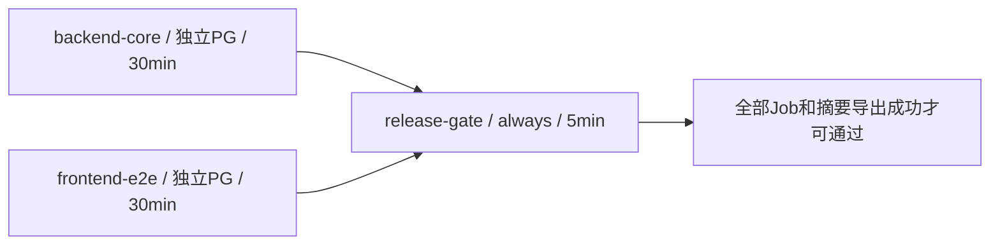

# V2.14-R2：CI reliability candidate

本轮只修改普通 CI 的调度与结果门禁，不修改电商领域、LangGraph、模型预算或评测答案。源基线 `01f0115f6fa704dec7a272eab57579d21d8f4ae5`，独立本地分支 `codex/v214-r2-ci-reliability`。准确提交用 `git log -1 --format=%H -- docs/evidence/v214-r2/verification.json` 定位。

## 首次远程取消：直接证据

[V2.14 Run42655215470 / Attempt1](https://github.com/Cockatoo-xlk/AgentMall-Portfolio/actions/runs/42655215470) 绑定01f0115，Job129291789307为cancelled。Check Run annotation直接记录 **“The job has exceeded the maximum execution time of 30m0s”**；因此本次已确认直接取消原因是Job超时。不是仅凭约30分钟推测，也不是已证明的外部手动/并发取消或业务断言失败。

Job started_at为2026-11-09 16:29:02 UTC，completed_at为16:59:19；Run开始16:28:59。配置30分钟，最终清理/停止回报有额外延迟，不将30分17秒说成放宽后的预算。完整REST Job、Check Run annotations、原始日志和Artifact保存在本地忽略目录，未改写原Run。

API时间戳为秒级；下表0秒不代表该步骤没有开销。

| 原串行步骤 | API时间差 | 结论 |
|---|---:|---|
| Set up job | 1s | success |
| Initialize containers | 10s | success |
| Check out source | 2s | success |
| Set up Python | 9s | success |
| Set up uv | 1s | success |
| Set up Node | 4s | success |
| Install locked Python dependencies without BGE extras | 4s | success |
| Install locked frontend dependencies | 47s | success |
| Install Playwright Chromium and Linux dependencies | 21s | success |
| Initialize fresh owned PostgreSQL and verify migration/seed/checkpoint | 4s | success |
| Ruff check | 1s | success |
| Ruff format check | 0s | success |
| PostgreSQL, checkpoint, invariants, oracle and provider protocol tests | 1345s | success |
| Frontend typecheck | 6s | success |
| Frontend lint | 3s | success |
| Frontend unit tests | 2s | success |
| Frontend build | 7s | success |
| Real FastAPI, PostgreSQL and checkpoint with fixture model E2E | 345s | cancelled |
| Write bounded public CI summary | 0s | success |
| Upload only public status summary | 1s | success |
| Post Set up Node | 0s | skipped |
| Post Set up uv | 0s | skipped |
| Post Set up Python | 0s | skipped |
| Post Check out source | 1s | success |
| Stop containers | 0s | success |
| Complete job | 0s | success |

pytest步骤22分25秒；测试引擎正文为1220 passed /14 skipped、1336.87秒。Vitest127通过。Playwright在16:53:30开始，相对Job开始后的30分钟截止仅剩 **5分32秒**，实际步骤345秒后取消。原始日志有108条通过、0条浏览器断言失败标记，但没有完整119项的成功回执；余下11项及最终浏览器结果不能宣称通过。故意注入的rollback RuntimeError并非测试失败。摘要Artifact成功上传不能改变cancelled结论。

原公开Artifact13694450440为391字节，ZIP SHA256 `1359cdd3c61cbb66978f0c383798032a0bcde0782dd44d835c39ee8f2d7c616f`；其PLAYWRIGHT字段为cancelled。原Runner CPU/RAM峰值没有遥测，**RESOURCE_BOTTLENECK=UNKNOWN**。能够量化的是串行时间预算，不把慢测试臆断为OOM或CPU不足。

## 新Job DAG与失败传播

Backend与Frontend没有needs依赖，各用GitHub独立Ubuntu24.04 Runner和独立PostgreSQL17/pgvector服务；同样的loopback55433只存在于各自Runner网络，不能解释为共用数据库。选择两条测试流水线避免把Python依赖、迁移、服务启动再复制到第三个测试Job。Gate单独运行标准库脚本，不装业务依赖。

- Backend：Python3.12.10 / uv0.9.18 / locked依赖、完整bootstrap、Ruff、format、完整pytest。无需Node/Chromium。
- Frontend：同样Python/bootstrap，Node24.21.0 / npm ci / Chromium、TypeScript、ESLint、Vitest、build、完整Playwright。不是依赖Backend留下的数据或进程。
- Gate：`needs: [backend-core, frontend-e2e]`，显式always且排除T16分支；所有required result必须success。failure、cancelled、skipped、空或未知值均阻断。
- 每个测试Job的summary检查安装/初始化/测试等全部步骤。上传失败使该Job失败。Gate最后的always enforcement还检查自身checkout、summary和upload；防止上游成功、导出失败仍得到绿色。
- Artifact仅包含封闭枚举状态、准确SHA/Run/Attempt、Fixture声明，单文件上限4096字节；明确 `workflow_conclusion=NOT_DETERMINED_BY_ARTIFACT`。导出前产生的Artifact不能证明自身上传或最终Job结论。最终GitHub Job/Workflow才是远程权威。取消整个Workflow可能阻止收尾摘要，但不能变成成功。

根级`contents: read`、persist-credentials=false、所有Action的40位固定SHA、Python/Node/uv及依赖锁保持。普通分支concurrency仍可取消旧Run，因此被取消不是成功；不加Secrets、缓存服务、continue-on-error或新远程脚本。T16触发输入、branch guard、Attempt1、reusable workflow和其文件内容保持不变。

## 旧新检查等价性

| 原offline-core检查 | 新位置 | 范围 |
|---|---|---|
| Python依赖/bootstrap | Backend + Frontend | 分别初始化；0011、pgvector0.8.7、Legacy3用户/12SKU、seed幂等、Checkpoint及probe清理 |
| Ruff / format | Backend | 原`backend evals scripts`全范围 |
| pytest | Backend | 原`--ci-offline-core --strict-markers -ra`，未筛掉Worker/事务/Oracle/Checkpoint/Provider协议/Single/Multi |
| Node / Chromium | Frontend | 原锁定安装命令，不下载BGE权重 |
| TypeScript / ESLint / Vitest / Build | Frontend | 原完整npm命令 |
| Playwright | Frontend | 完整119项；workers1、retries0、fullyParallel=false、timeout30000均未改 |
| 状态Artifact | 各Job + Gate | 更严格的闭合状态判定，不上传日志、Trace或原始数据 |

后端旧用例与本轮JUnit节点集合比较见verification.json；新增控制测试独立计数。14项原skip边界保持：13项依赖未挂载真实BGE、1项私有Live原件比较。历史Fixture/Oracle、业务逻辑、锁文件和前端测试配置均不修改。

## 本地验证与时间预算

实际执行结果、完整命令、UTC、wall-clock及日志SHA见[verification.json](verification.json)。测试在Mac Docker Desktop下Linux **aarch64**，不是GitHub Ubuntu amd64。构建使用可信本地依赖/Chromium缓存和显式公开源码清单，uv按锁同步；冷安装与新GitHubArtifact上传均未在本地模拟为已完成。

时间预算以原远程实测分解：Backend可移除Node4秒、npm47秒、Chromium21秒和全部前端检查，不再把E2E塞入末尾5分32秒。按旧pytest22分25秒，Backend预计约23–24分钟；Frontend拥有完整独立30分钟，预计约9–12分钟（尚无新的amd64测量）。关键路径为两者最大值加Gate，不是两者相加。不是加到60分钟，不调整90秒业务Run或12次模型上限。

若新Ubuntu Backend仍超30分钟，应先用实际durations/资源证据辨别Worker故障注入等待、依赖冷装或资源问题，再审核是否拆分测试集合/可信缓存/合理timeout；禁止直接提高上限宣称解决，也不并行化共享端口/重置Schema的Playwright。当前remote性能仅预测。

## 本轮实际结果（源码内容绑定）

- 完整pytest **1291 passed /14 skipped /0 failed**，测试引擎559.55秒，含新增71项CI控制测试；额外JUnit导出产生4条record_property兼容警告，不改业务断言。原1220项通过用例完整保留。旧新JUnit分别1234/1305节点，原14项skip完全相同。三个历史安全测试的参数ID来自uuid4，原始字符串比较先失败；仅在比较器里规范化已确认的3个随机后缀后，旧节点缺失0。原始源码及断言未改，失败和修正均保留。
- Vitest **127 passed**；Playwright **119 passed /0 skipped /0 flaky /0 retries**，JSON reporter独立核对；浏览器步骤201.165秒。所有Ruff/format/TypeScript/ESLint/build/actionlint退出0。
- 主机门禁71项，两套独立Guest各77项（71门禁+6原bootstrap）通过；有真实CLI非零退出验证，并非只断言Python布尔值。原串行DAG RED为1 failed/62 passed，新增拓扑及实现后GREEN。独立静态审查无Critical/Important/Minor。
- 两个bootstrap分别1.779/1.740秒，PG17.11、pgvector0.8.7、Alembic0011、Legacy12SKU、幂等及Checkpoint检查通过。两个物理数据库在测试后各自独立只读SQL确认test_/cp_残留0；浏览器服务进程查无。
- 本地Backend流水线563.113秒，Frontend208.146秒，两者真实并行；同样已测步骤若串行求和为771.259秒，重叠关键路径约563秒。该对比不含缓存安装/Runner配置，**不能外推新Ubuntu加速比例**。镜像构建31.78秒；Node196个已装包与当前lock无差异，其余47为其他平台可选项，npm/Chromium冷安装NOT_RUN。
- Runner峰值Backend985,493,504字节、Frontend1,959,223,296字节；两个PG分别805,380,096 /196,493,312字节。各cgroup OOM/oom_kill均0；Backend PG触及内存上限计数4222，存在回收压力，不能声称资源完全宽裕。CPU usage及throttle原始计数见JSON；不据此推断旧远程瓶颈。
- 仅本轮4容器、2 Volume、2个缓存Runtime及新镜像tag保全后删除，owner独立查询均查无；25个历史容器ID/名称/状态未变，默认Context仍colima。39份原Live文件与475份旧公开代码/证据哈希保持。共享BuildKit缓存不清理。

**LOCAL_VALIDATION_PASSED / NO_PUSH / REMOTE_CI_NOT_RUN_FOR_R2 / NO_LIVE_REQUESTS / NO_DEPLOY**。AMD64_REMOTE_CI_NOT_RUN_FOR_R2。可执行内容453文件SHA256：`cbd250ee27203ace20be2a129258fcfdc7899cf301d44506dbd853dc72adc8f1`（算法及范围见JSON；交付文档不纳入，避免自引用）。这不是GitHub成功回执或真实模型成功。

## 安全、资源、发布边界

本轮两套容器/Volume仅用于本轮owner；不同PG网络命名空间，无宿主端口、无互联网出口、无Provider Key注入，HF离线。只清理本轮可验证owner资源，历史25容器和39份原始Live文件不变。清理、OOM及峰值原件在verification.json；不清理共享BuildKit缓存。原始日志、SQL、JUnit及浏览器失败截图保留在Git忽略私有目录，目录0700、文件0600。

安全检查覆盖差异、Action来源、表达式注入、封闭摘要、当前文件及HEAD可达历史。公开fixture密码仅用于一次性测试PG；不存在新增Secrets。未发现模式匹配的真实秘密不等于数学证明无泄漏。

V2.14首次Push已成功，旧Run取消事实保留；本轮 **NO_PUSH / REMOTE_CI_NOT_RUN_FOR_R2 / AMD64_REMOTE_CI_NOT_RUN_FOR_R2 / NO_LIVE_REQUESTS / NO_DEPLOY**。产品L7 B2仍是PARTIAL / CONTEXT_SCOPE_VIOLATION，本轮不做L8、不调预算、不将离线CI修复说成真实模型修复。

下一步：所有者审阅本轮准确新Commit、Diff和门禁结果后，另行授权新审核分支的一次非强制Push；普通自动CI应产生Backend、Frontend、Gate的真实Attempt1结果与有界摘要。核对所有Job和SHA，失败停止、不自动Rerun。main、PR、Release、部署及Live始终需另行授权。

## 执行中作出的工程判断

| 判断 | 依据与代价边界 |
|---|---|
| 复用现有linked worktree，新建独立本地分支、最终一笔Commit，保留私有计划和失败原件 | 用户明确本地自主执行；Diff/源码哈希限制范围。若判断错误，风险是隔离范围不足，当前旧分支/历史原件均未改。 |
| 独立审查时后端尚未结束，不以target/collection代替全量结果 | 随后从实际完整JUnit核验1291/14；否则会漏掉真实回归。 |
| 独立审查未覆盖最终receipt/cleanup/commit，交由执行者后续实证核验 | 独立owner查无及最终Git检查必须通过；否则不能宣称候选就绪。没有第二轮重复审查。 |
| Ubuntu amd64和真实Actions取消/收尾行为未运行 | 明确保留REMOTE_CI_NOT_RUN_FOR_R2；若直接外推，会误报远程可靠性与性能。 |
| 不修改远程branch protection | 本地源码审核不能证明required checks配置；未来如需将新Gate设为必需项，必须另行批准远程设置，否则merge策略可能未要求新名称。 |
| 仅规范化三个已验证uuid4参数后缀再比较旧新节点 | 函数、参数field、节点总数、skip及完整源码哈希仍严格比较；若泛化替换范围会掩盖参数变化，因此没有进行泛化处理。 |

独立审查未提出待修复或延期的Minor。本轮最终候选仍需所有者审核并单独批准远程发布。
